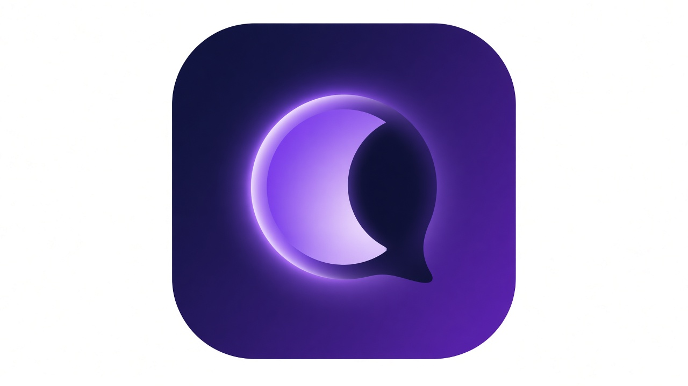

<h1 align="center">Umbra</h1>

<b>Talk in the shadows.</b> 
Peer-to-peer, end-to-end encrypted chat, voice, and video for Android, Windows, and Linux.

Umbra connects you directly to the people you talk to. Messages and calls are encrypted on your device
with well-known, audited building blocks, and go peer to peer whenever your network allows,
falling back to a relay only when it has to. No accounts on someone else's server, no ads, open source.

> ⚠️ **Early development.** Umbra has **not** had a security audit yet. Please don't rely on it for high-risk use.

## Goals
- E2E encrypted 1:1 and group chat built on well-known, audited primitives (no homemade crypto)
- Direct peer-to-peer connections, with relay fallback only when NAT forces it
- Encrypted voice and video calls (WebRTC, DTLS-SRTP)
- One codebase that ships to Android, Windows, and Linux
- Optional Tor routing for metadata privacy (experimental)

## Layout (planned)
- `app/` cross-platform client
- `core/` crypto, identity, and messaging protocol
- `calls/` voice and video
- `signal-relay/` optional self-hostable rendezvous/relay
- `docs/` architecture, threat model, protocol, and project docs
- `assets/branding/` logo concepts and brand palette

## Docs
- [Legal & compliance notes](docs/legal.md) (license fit, U.S. encryption export / EAR checklist — **not legal advice**)
- [Costs & sustainability](docs/costs-and-sustainability.md) (STUN/TURN stack, GitHub Sponsors)
- Branding concept art: [`assets/branding/umbra-icon-concept.jpg`](assets/branding/umbra-icon-concept.jpg)

### Cryptography notice
This distribution may include cryptographic software. The country in which you reside may restrict import, possession, use, and/or re-export of encryption software. Check your local laws before use.

## License
[GNU Affero General Public License v3.0](LICENSE) (AGPL-3.0)
