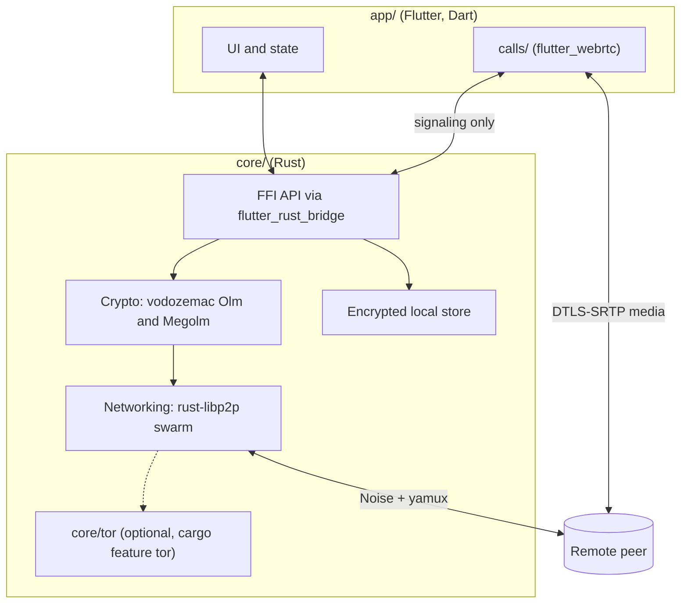

# Umbra architecture

Status: **design draft**. This describes the intended shape of Umbra, based
on the agreed stack. `core/`, `app/`, and `calls/` are still being built, so
treat anything here that disagrees with the code as a bug in this doc and fix it.

Umbra is a peer-to-peer, end-to-end encrypted messenger with voice and video
calls for Android, Windows, and Linux. There is no Umbra server. Peers find and
talk to each other directly over libp2p, and every message is end-to-end
encrypted with vodozemac before it reaches the network.

License: AGPL-3.0.

## Components

| Directory | Language | Owner | Responsibility |
| --- | --- | --- | --- |
| `core/` | Rust | Elite | Identity, crypto sessions, networking, storage, the FFI surface |
| `core/tor/` | Rust | Val | Optional Tor transport (`umbra-tor`), see [tor.md](tor.md) |
| `app/` | Dart/Flutter | Copilot | UI, contacts, chats, settings, platform glue |
| `calls/` | Dart (flutter_webrtc) | Gem | Voice and video, signaling over the core's encrypted channel |
| `packaging/` | scripts | Sally | App IDs, icons, AppImage, tarball, zip, MSIX, Android signing |
| `.github/workflows/` | YAML | Cali | CI and tag-triggered releases |

### Rule of thumb

Anything that touches keys, plaintext-to-ciphertext, or the network lives in
Rust. Dart only ever sees decrypted messages to render and opaque handles. That
keeps the security-relevant code in one memory-safe, testable place, and lets
`core/` be fuzzed and tested without a Flutter toolchain.

## Identity

Each install has one **device identity**:

- A **libp2p keypair** (Ed25519), which gives the `PeerId` used for routing and
  for the Noise handshake.
- A **vodozemac `Account`** with an Ed25519 signing key and a Curve25519
  identity key, which is used for Olm sessions.

The two are bound together: the vodozemac Ed25519 key signs the `PeerId`, and
that signed bundle is what a contact gets when they add you (by QR code or
invite link). A contact therefore pins *both* keys at add time, and a later
connection from the right `PeerId` but the wrong vodozemac key (or the reverse)
is rejected.

There are no usernames, phone numbers, or emails. The user-facing identity is
a display name the user picks plus a **safety number** derived from the two
public keys, which two people can compare in person or over a call.

Multi-device (one person, several devices) is **out of scope for v1**. Each
device is its own identity. When it's added, it'll follow the Matrix model of
cross-signing device keys with a user master key.

## Crypto

All crypto comes from **vodozemac** (Matrix's audited Rust implementation of
Olm and Megolm). Umbra doesn't implement any primitives itself.

- **1:1 chats** use **Olm** (a Double Ratchet with X3DH-style session setup).
  Since there's no server to host one-time keys, the inviting side's QR code or
  invite link carries a fresh one-time key, and further one-time keys are
  exchanged directly once a session exists.
- **Groups** use **Megolm**. Each member creates an outbound Megolm session and
  shares its session key with every other member over their pairwise Olm
  sessions. The session is rotated when membership changes or after N messages
  or T time (defaults to be decided in `core/`).
- **Message envelope.** The plaintext is a serialized message (text,
  attachment pointer, reaction, receipt, or call signal) with a random padding
  bucket. It's encrypted by vodozemac, and the ciphertext and sender key ID go
  in a small framed envelope on the wire.
- **Attachments** are encrypted with a fresh random key (AES-256-GCM or
  XChaCha20-Poly1305, to be decided) and sent as a separate stream. The key and
  hash travel inside the E2E-encrypted message.

## Networking

**rust-libp2p** with:

- **Transports.** TCP and QUIC, plus the optional Tor transport (TCP only)
  when built with `--features tor`.
- **Security and muxing.** Noise XX and yamux (QUIC has its own TLS 1.3). The
  Noise layer authenticates the `PeerId`, but Umbra does **not** rely on it for
  confidentiality of content. That's vodozemac's job.
- **Discovery.**
  - Kademlia DHT to find a contact's current addresses by `PeerId`.
  - mDNS on the LAN. **Off by default** and always off when Tor is on,
    because it broadcasts presence.
  - Contacts also gossip each other's last known addresses.
- **NAT traversal.** AutoNAT, Circuit Relay v2, and DCUtR hole punching. Relays
  only see ciphertext.
- **Messaging protocol.** A request-response protocol
  (`/umbra/msg/1.0.0`) carries envelopes, and each send is acked.

### Offline delivery

Pure P2P means a message can only be delivered while both devices are online.
v1 handles this with an **outbox**: undelivered envelopes stay encrypted in the
local store and are retried whenever the recipient becomes reachable.
Store-and-forward through mutual contacts or relays (holding ciphertext with a
TTL) is a possible later addition and needs its own threat-model pass.

There are **no push notifications** through Google or Microsoft in v1. On
Android, a foreground service keeps the swarm alive while the user allows it.
The tradeoff (battery use, and only receiving messages while running) has to be
spelled out to users.

## Calls

`calls/` uses **flutter_webrtc**.

- **Signaling** (SDP offers and answers, ICE candidates, hangup) is sent as
  ordinary Umbra messages, so it's end-to-end encrypted and authenticated by
  Olm. No third-party signaling server is used.
- **Media** runs over WebRTC's own DTLS-SRTP. The DTLS certificate fingerprint
  is inside the SDP, and the SDP only travels through the encrypted channel, so
  a relay or network attacker can't swap in their own fingerprint. That's what
  makes calls end-to-end, not just hop-by-hop.
- **ICE and TURN.** Direct or STUN-assisted connections reveal each peer's IP
  to the other. A TURN relay hides it but needs a server, and which TURN
  servers to use (if any, and whether self-hosted) is still open.
- **Calls don't go through Tor.** WebRTC media is UDP, and Tor only carries
  TCP. With Tor on, the app has to warn before a call that it'll reveal the
  user's IP to the other person, or else force TURN.

Group calls are out of scope for v1. A mesh of up to about 4 people would be
possible later. Anything bigger needs an SFU, which doesn't fit a P2P design.

## Local storage

- A SQLite database in the app's private directory, encrypted at rest
  (SQLCipher or page-level encryption in `core/`, to be decided).
- The database key is generated on first run and stored in the **OS keystore**
  (Android Keystore, Windows DPAPI or Credential Manager, and Linux Secret
  Service through libsecret). If that's not available, the app falls back to a
  user passphrase run through Argon2id.
- vodozemac `Account` and session pickles are stored inside that database,
  encrypted with the pickle key.
- On Android, the store is excluded from cloud and adb backups
  (`android:allowBackup="false"` plus data extraction rules).

## FFI boundary

`flutter_rust_bridge` generates the Dart bindings. The surface is kept small
and coarse-grained, for example `send_message(chat_id, body)`,
`stream_events() -> Stream<Event>`, and `start_call_signaling(peer)`. Rules:

- Private keys never cross the FFI boundary.
- Errors cross as typed enums, not strings that have to be parsed.
- Long-running work runs on the Rust tokio runtime, and Dart just awaits
  futures or listens to streams.

## Build and release

CI (`.github/workflows/ci.yml`) runs fmt, clippy, and tests for the Rust
crates and analyze and test for the Flutter app, and it builds the Android APK,
the Windows zip, and the Linux tarball and AppImage. Each job skips until its
directory exists. Tagging `v*` runs `release.yml`, which attaches every
artifact plus `SHA256SUMS` to a GitHub release. Android release signing reads
the keystore from GitHub secrets only. Details are in [ci.md](ci.md) and
`packaging/README.md`.

## Open decisions

1. Attachment cipher (AES-256-GCM vs XChaCha20-Poly1305).
2. Encrypted-at-rest approach (SQLCipher vs encryption in `core/`).
3. Megolm rotation defaults.
4. TURN: none, self-hosted, or user-configurable.
5. Store-and-forward for offline delivery.
6. Whether QUIC stays on when Tor is on (it has to go off to avoid leaking the IP).

See [threat-model.md](threat-model.md) for what this design does and doesn't
protect against.
