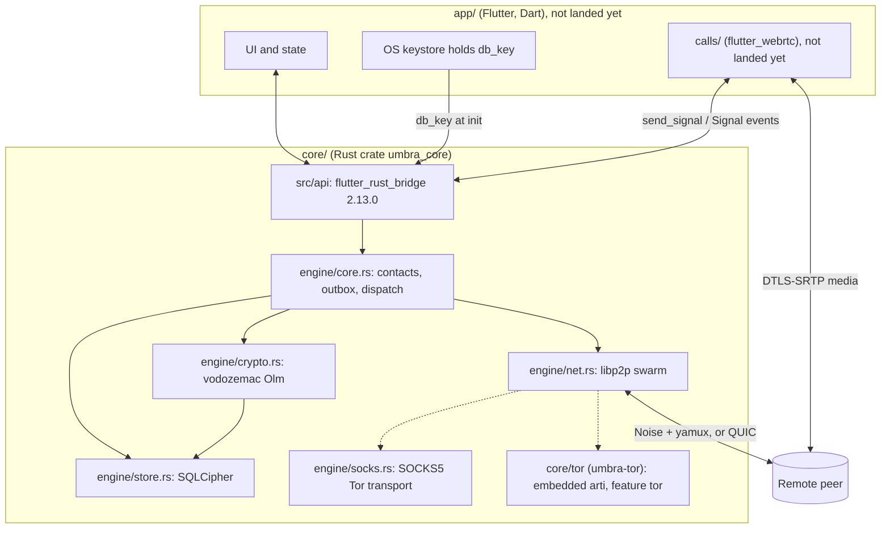

# Umbra architecture

Status: matches `core/` as of `119c53b` (Elite's core, PR #8). `app/` and
`calls/` haven't landed yet, so those sections describe the contract `core/`
exposes to them, not code that exists. When this doc and the code disagree,
the code wins. Fix the doc.

Umbra is a peer-to-peer, end-to-end encrypted messenger with voice and video
calls for Android, Windows, and Linux. There is no Umbra server. Peers talk
directly over libp2p (or through circuit relays when they can't), and every
message is Olm-encrypted by vodozemac before it touches the network.

License: AGPL-3.0-or-later.

## Components

| Path | Owner | Responsibility |
| --- | --- | --- |
| `core/` | Elite | Identity, Olm sessions, libp2p, SQLCipher store, outbox, FFI API. See [core-api.md](core-api.md) |
| `core/tor/` | Val | `umbra-tor`, the optional embedded-arti transport. See [tor.md](tor.md) |
| `app/` | Copilot | UI, contacts, chats, settings, and keeping `db_key` in the OS keystore |
| `calls/` | Gem | Voice and video over flutter_webrtc, with signaling through `core` |
| `packaging/` | Sally | App ID `io.github.femboynyx.umbra`, icons, AppImage, tarball, zip, MSIX, Android signing |
| `.github/workflows/` | Cali | CI and tag-triggered releases. See [ci.md](ci.md) |

Rule of thumb: anything that touches private keys, ciphertext, or the network
lives in Rust. Dart gets decrypted messages to render and plain data types.

## Identity

Each install is one device identity, made up of two keys:

- An **Ed25519 libp2p `Keypair`**. It derives the `PeerId` and authenticates
  the Noise handshake. The same key is the `ed` field of the contact card.
- A **vodozemac Olm `Account`**, whose Curve25519 identity key is the `ik`
  field.

Both are created on first `init` and stored in SQLCipher. The account is also
pickled with a key derived from `db_key`.

A **contact card** is an `umbra://add?peer=…&ik=…&ed=…&addr=…&name=…` link,
which goes in a QR code or gets shared as a link (`engine/qr.rs`).
`validate_card` checks that `ed` really derives `peer` and that `ik` is a valid
Curve25519 key. Two things to note:

- `ik` is **not signed** by `ed`. It's bound to the PeerId only by the card
  itself (which you trust as much as the channel it came through) and by the
  `Hello` exchange, which runs over a Noise connection authenticated as that
  PeerId. Once a contact is added, both keys are **pinned**.
- Key changes are refused, not warned about. `add_contact` fails if a stored
  contact's keys differ. `Hello` messages and one-time-key responses with
  different keys get rejected. The user has to remove and re-add the contact
  after verifying.

**Safety numbers** (`engine/safety.rs`) use Signal's numeric fingerprint
construction (version 0, 5200 SHA-512 rounds over `ed || ik || PeerId`). That
gives each side 30 digits, sorted and joined into a 60-digit number grouped in
12 blocks, which is the same on both devices. `set_verified` records that the
user compared it.

There are no usernames, phone numbers, or emails. Multi-device is out of scope:
each device is its own contact.

## Contacts and first contact

1. Alice scans Bob's card and calls `add_contact`.
2. When Alice connects, she sends `MsgRequest::Hello { card }`. If Bob hasn't
   added Alice, he answers `Rejected(NotAContact)` and his app gets a
   `ContactRequest` event with Alice's card. Alice's queued messages wait.
3. Once Bob accepts (`add_contact` with that card), either side can claim a
   one-time key and open an Olm session.

Only contacts can claim one-time keys or get Olm messages decrypted. Everything
from non-contacts is rejected before decryption.

## Crypto

All of it comes from vodozemac, libp2p, and RustCrypto. There's no custom
crypto.

- **1:1 only, Olm v1** (3DH plus Double Ratchet, compatible with libolm).
  `SessionConfig::version_1()`, since v2 is still experimental in vodozemac.
- **Session setup.** The sender claims a one-time key from the recipient over
  `/umbra/keys/1`. The response is only trusted if its `identity_key` matches
  the pinned one. Then the sender opens an outbound session, and the first
  message is an Olm pre-key message (`t = 0`).
- **Sessions.** Up to 4 per peer are kept (`MAX_SESSIONS_PER_PEER`), and the
  oldest are pruned. Messages are encrypted with the most recently used
  session. Decryption tries the matching session, and a pre-key message can
  create a new inbound one. If both sides open sessions at once, they
  converge, and there's a test for it.
- **Plaintext** is a JSON `Payload { v, to, id, ts, body }`. `to` is the
  intended recipient's PeerId and is checked after decryption, so ciphertext
  sent to the wrong peer is rejected. `body` is `Text` or `Signal`.
- **Not implemented yet:** groups (Megolm), attachments, padding, and
  disappearing messages.

## Wire protocols

These run over libp2p request-response with the CBOR codec (`engine/proto.rs`).

| Protocol | Request | Response |
| --- | --- | --- |
| `/umbra/msg/1` | `Hello { card }` or `Olm { t, c }` | `Ok`, `Delivered` (the delivery ack), or `Rejected(NotAContact / DecryptFailed / Malformed / Internal)` |
| `/umbra/keys/1` | `ClaimOneTimeKey` | `Key { identity_key, one_time_key }` or `Refused(reason)` |
| `/umbra/kad/1.0.0` | Kademlia | Umbra's own DHT protocol name, separate from the public IPFS DHT |
| `/umbra/id/1.0.0` | identify | |

Limits: text and signal payloads are each capped at 64 KiB, `call_id` at 128
bytes. Requests time out after 20 s, and idle connections close after 300 s.

## Networking

`engine/net.rs` has two modes.

**Clearnet (the default).** TCP, QUIC, and DNS, with Noise plus yamux (QUIC
uses its own TLS). It also runs a circuit relay v2 client, DCUtR hole
punching, identify, ping, and Kademlia. mDNS only runs if
`CoreConfig.enable_mdns` is set. By default it listens on
`0.0.0.0` and `::` over TCP and QUIC.

**Tor-only.** This happens when `tor_socks` is set (system Tor or Orbot,
through `engine/socks.rs`) or in a build with the `tor` feature (embedded
arti). In this mode:

- dials are TCP through Tor only, with no QUIC and no clearnet,
- nothing listens locally,
- mDNS and DCUtR are off,
- Kademlia runs in client mode,
- identify hides listen addresses,
- inbound connections only come through `relay_addrs` circuits.

**Discovery.** Contacts' last-known addresses come from cards and `Hello`.
Kademlia `get_closest_peers` finds peers that have moved. Bootstrap and relay
peers come from `CoreConfig` (`bootstrap_addrs` and `relay_addrs`). Core doesn't
ship any defaults, so who runs those nodes is an open decision. Hosting
costs for relays and TURN are in
[costs-and-sustainability.md](costs-and-sustainability.md).

## Offline delivery (outbox)

`send_text` saves the message and adds it to the `outbox` table. When a contact
reconnects (or sends `Hello`), core greets them and sends that contact's queued
messages in order. A message comes off the queue once it's `Delivered`. If the
contact hasn't accepted us yet, the queue stops and waits for their `Hello`.
Queued messages expire after **7 days** (`OUTBOX_TTL_MS`).
Message delivery only happens while both devices are online at the same time.
There's no store-and-forward and no push. Push notifications through Google or
Microsoft would leak metadata to them, so they're deliberately left out.

## Calls (contract for `calls/`)

`send_signal(peer, call_id, kind, payload)` sends `Offer`, `Answer`,
`IceCandidate`, `Ringing`, `Reject`, or `Hangup` as an Olm-encrypted `Signal`
payload. It isn't stored or queued, and it fails if the peer can't be reached
right now (25 s timeout). Incoming signals show up as `CoreEvent::Signal`.

Since the SDP only travels inside Olm, the DTLS fingerprint in it can't be
swapped by a relay or network attacker. **`calls/` must only accept SDP that
comes from `CoreEvent::Signal`**, or media isn't end-to-end.

WebRTC media is UDP and never goes through Tor. Direct ICE reveals each side's
IP to the other. The TURN policy (none, self-hosted, or user-set) is still open.

## Local storage

- SQLCipher (`rusqlite 0.37`, `bundled-sqlcipher`, plus vendored OpenSSL on
  Android, iOS, and Windows). The tables are `meta`, `contacts`,
  `olm_sessions`, `messages`, and `outbox`.
- `db_key` is 32 random bytes that **the app** generates and keeps in the OS
  keystore (Android Keystore, Windows DPAPI, or libsecret). It's passed to
  `init` and applied as a raw SQLCipher key. Core never writes it anywhere. If
  the key is wrong, opening fails.
- The Olm account and session pickles are also encrypted with
  `HKDF-SHA256(db_key, salt "umbra-core", info "olm-pickle-v1")`.
- Key material in core is wrapped in `zeroize::Zeroizing` where it's handled
  directly (`db_key` pragma string, device key bytes, pickle key).
- Message bodies are stored as plaintext *inside* the encrypted database,
  because the UI needs them.

## FFI boundary

The API lives in `core/src/api/` (`umbra.rs` and `types.rs`), and the full
reference is in [core-api.md](core-api.md). The main calls are `init`,
`start_network`/`stop_network`, `events` (a stream of `CoreEvent`),
`self_info`, `parse_qr`, `add_contact`, `set_verified`, `remove_contact`,
`send_text`, `list_conversations`, `list_messages`, `mark_read`, and
`send_signal`. `CoreConfig { mock: true }` runs an in-memory fake backend for
UI work.

Private keys never cross to Dart. The one secret that crosses is `db_key`, and
it goes **into** core from the app at `init`. `SelfInfo` and `Contact` only
carry public keys and safety numbers.

## Build and release

There's CI for `core/` (fmt, clippy, tests with `--locked`, Rust 1.89 or newer)
and, once they land, `app/` and the platform builds. Tagging `v*` makes a
release with every artifact plus `SHA256SUMS`. Android signing comes only from
secrets. The details are in [ci.md](ci.md).

## Open decisions

1. Who runs the bootstrap and relay nodes, and whether core ships defaults.
2. Groups: Megolm, and how rotation works. Proposed in [servers.md](servers.md).
3. Attachments: how they're sent, the cipher, and size limits.
4. Padding message sizes.
5. TURN policy for calls, and what the UI says about the IP leak.
6. Whether the `ik` should be signed with `ed` in the card. Defense in depth,
   see the threat model.
7. Store-and-forward for offline delivery.

See [threat-model.md](threat-model.md) for what this does and doesn't protect.
