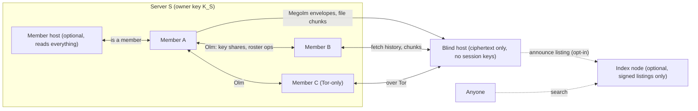
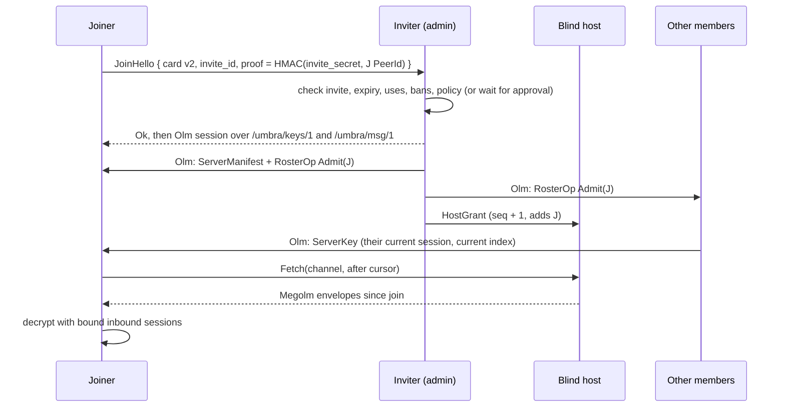

# Community servers (design)

Status: **design only, nothing here is implemented.** Written against main at
`e92d367`. It builds on what core does today, described in
[architecture.md](architecture.md), [threat-model.md](threat-model.md),
[core-api.md](core-api.md) and [tor.md](tor.md). Numbers marked
**(proposed)** are design defaults we picked and can change. Everything
else is either read from the code or cited.

Nyx asked for Discord-style servers: channels, mostly peer-to-peer and hosted
by the community, with optional discovery somewhere else, contents hidden from
everyone outside the server, and file uploads, GIFs and link embeds. This doc
says how to build that on top of the current core, and where the security
story is weaker than "encrypted" suggests.

## Summary of decisions

| Topic | Decision | Differs from Chi's call? |
| --- | --- | --- |
| Group crypto | vodozemac Megolm v1, one outbound session **per sender per channel**, keys shared over Olm | Yes, Megolm is per sender, not per channel. See [Group crypto](#group-crypto) |
| Hosts | Default host is a **blind store-and-forward host**. It holds ciphertext and never gets session keys. A **member host** (headless member that reads everything) is allowed but labelled as one | Yes. Chi's host is a member, and a member host can read everything |
| Who can talk to whom | New "co-member" trust class in core, because Olm today only works between mutual contacts | New. Chi's call assumed existing Olm channels between members, and they don't exist |
| Membership | Owner-signed manifest with a sequence number, plus admin-signed roster ops | Mostly agrees. Adds rollback and fork rules, recovery keys and ownership transfer |
| Bans | Enforced by rotation and host ACLs. A banned member keeps whatever they already decrypted or hold keys for | Agrees, with that limit stated plainly |
| Index | Opt-in signed listings on a new `/umbra/index/1` protocol that anyone can run | Agrees. Adds that announcing and searching reveal IP and PeerId unless Tor is on |
| Public servers | Allowed, but labelled honestly: anyone who can join can read | New caveat |
| Files | Chunked, content-addressed, one key per file, fetched over a separate `/umbra/blob/1` | Agrees. Adds that fetching reveals your IP to whoever serves the chunks |
| Embeds and GIFs | Sender-side previews, GIF search off by default with a warning | Agrees |
| Names | The suffix is for **telling people apart, never for trust**. Hash-derived suffixes can be ground cheaply at any length people would read | Yes. A short suffix can't be made grind-proof (math in [Names](#names-and-impersonation)) |

## What exists today and what servers need

| Need | Core at `e92d367` | Gap |
| --- | --- | --- |
| Encrypt to many peers | Olm v1 for 1:1 only. `PayloadBody` is `Text` or `Signal` | Megolm sessions, new payload kinds |
| Talk to a member who isn't your contact | Not possible. `Hello` from a non-contact gets `Rejected(NotAContact)` and raises `ContactRequest`. One-time keys are only served to contacts | Co-member trust class (below) |
| Offline delivery | Outbox only, 7-day TTL, and both peers have to be online at once | Hosts store and forward server traffic |
| Key change handling | `CoreEvent::KeyChanged`, `accept_key_change`, `reject_key_change` (PR #20) | Apply the same pins to co-members |
| Abuse limits | Token buckets in `engine/limits.rs` on `Hello`, contact requests and OTK claims (PR #20) | Per-member post, key-share and blob limits |
| Tor | SOCKS or embedded arti, dial-only. Onion listening is experimental behind `tor-listen` | Tor-only members can't receive direct fan-out, so they rely on hosts |
| `ik` bound to `ed` | Not signed, see threat model | Becomes a prerequisite (below) |

### Prerequisites in core

1. **Sign `ik` with `ed` (contact card v2).** Today `ik` is trusted because it
   arrived in a card you scanned or in a `Hello` over a Noise connection
   authenticated as that PeerId. In a server you get other members' keys from
   an admin's roster entry, not from your own scan. If the card carries
   `sig = ed25519_sign(ed, "umbra-card-v2" || PeerId || ik)`, any copy of a
   member entry can be checked on its own, and an admin can't attach a wrong
   `ik` to a real PeerId.
2. **Co-member trust class.** A peer whose card (with a valid v2 signature) is
   in the current roster of a server we're in may complete `Hello`, claim
   one-time keys and send Olm messages, but **only server-scoped payloads**
   are accepted from it. A `Text` DM from a co-member who isn't a contact is
   handled like a contact request (see open questions). The existing
   per-peer buckets apply to co-members just as they do to contacts.
3. **Pins carry over.** If a co-member is also a contact, or appears in two
   servers, all copies of their keys have to match. A mismatch raises
   `KeyChanged` and stops key sharing to and from that peer until the user
   resolves it.
4. **Generalise the outbox** so it can queue server-scoped Olm payloads (key
   shares, roster ops) as well as `Text`.

## Overview



## Identifiers

| ID | Form | Notes |
| --- | --- | --- |
| `ServerId` | SHA-256 of the canonical CBOR of the genesis manifest, unpadded base64url | Commits to the first owner key, and stays the same across ownership transfers |
| `ChannelId` | 16 random bytes | Random, so hosts never see channel names |
| Member | Device PeerId plus the v2 card | One device is one member, like contacts today. Multi-device is still out of scope |
| `SessionId` | vodozemac `GroupSession::session_id()`, the session's Ed25519 public key in base64 | Globally unique |
| `MessageId` | UUID v4, as today | Deduplicated per server |
| `BlobId` | SHA-256 of a ciphertext chunk | Hosts can check a chunk without the key |

Every server also has a hidden **control channel** that every member can
read. It carries manifests and roster ops in Megolm, so a host can hold them
for offline members without being able to read them.

## Group crypto

### Megolm in vodozemac 0.11.1

Read from `~/.cargo/registry/src/*/vodozemac-0.11.1/src/megolm/`:

- `GroupSession::new(SessionConfig::version_1())` makes an outbound session
  with a random ratchet and its own Ed25519 signing key. `encrypt` produces a
  `MegolmMessage` that carries the `message_index` and is signed by that key.
  `session_key()` returns a `SessionKey` at the current index, signed by the
  session key.
- `InboundGroupSession::new(&SessionKey, config)` makes the receiving side.
  `decrypt` checks the signature and MAC and returns the plaintext and its
  `message_index`. It fails with `UnknownMessageIndex` for indices below
  `first_known_index()`.
- `export_at(index)` and `export_at_first_known_index()` produce an
  `ExportedSessionKey`, which has no signature. `InboundGroupSession::import`
  takes it. `advance_to(index)` permanently forgets earlier keys.
  `compare` and `merge` pick the better of two copies of the same session.
- Megolm v1 uses AES-256 with HMAC **truncated to 8 bytes**. v2 (full MAC) is
  behind vodozemac's `experimental-session-config` feature, which we don't
  enable, matching our choice of Olm v1. Pickles encrypt with a 32-byte key,
  just like the Olm pickles.

### Sessions

Megolm sessions are **per sender**: a `GroupSession` belongs to whoever sends
with it, and receivers hold an `InboundGroupSession` for each sender. So each
member keeps one outbound session per channel they post in, and an inbound
session for every other active sender in that channel. Chi's "a Megolm
session per channel" works out to one per sender per channel.

Sharing: before a member's first send in a channel (and after every
rotation), core sends `ServerKey { server_id, channel_id, session_key }`
over Olm to every current roster member who can read the channel. The
receiver stores the inbound session **bound to the Olm sender's PeerId**,
`server_id` and `channel_id`.

**Binding rule (the same lesson as the calls spoofing fix in #22).** On
decrypt, the sender, server and channel come from the stored binding, never
from the plaintext. The plaintext repeats `server_id` and `channel_id`, and
the message is dropped if they don't match the binding. A member can't post
as someone else, because they'd need that sender's session signing key, which
never leaves the sender.

### Rotation

| Trigger | What happens |
| --- | --- |
| A member leaves, is kicked or is banned | Every remaining member marks their outbound sessions for the affected channels as stale, and makes a new session before their next send, shared only to the new roster |
| A member loses read access to a channel | The same, for that channel only |
| Time or message count | Rotate after **7 days or 100 messages, whichever comes first (proposed)**. These are Matrix's defaults for `m.room.encryption` (`rotation_period_ms` and `rotation_period_msgs`) |
| A member joins | No rotation. Senders share their current session at its current index, so the new member can't read earlier messages unless history is shared on purpose (below) |

What rotation can't do:

- **No post-compromise security inside a session.** Whoever has a session key
  at index *i* can decrypt every later message in that session until it's
  rotated. Megolm's ratchet only goes forward, so you get forward secrecy
  against earlier indices only if the receiver calls `advance_to` and throws
  the older copy away.
- **A removed member keeps what they had.** They can still read every message
  they had keys for, including ciphertext a host keeps serving. Rotation
  protects messages sent after the removal, not before.
- **Cost.** Each rotation is one Olm message per reader, so a burst of
  rotations in an *N*-member channel with *N* active senders is about *N²*
  Olm messages. Phase 1 caps servers at **250 members (proposed)** for that
  reason.

### History for new members

| Policy | Behaviour |
| --- | --- |
| `joined` (default, proposed) | You can read from the moment you joined |
| `shared` | An admin's client forwards `export_at(index)` keys for the recent history window. The receiver marks those sessions as "forwarded by X", because an `ExportedSessionKey` isn't signed, so you're trusting X's Olm channel to bind the key to the original sender |

### Missing keys

If a Megolm message arrives for an unknown `SessionId`, core keeps it in a
bounded pending queue (**500 messages per server, 7 days (proposed)**) and
sends `ServerKeyRequest` to the bound sender only, if that sender is in the
roster and reachable. The UI shows "Waiting for this message's key."

## Hosts

A host is an always-on node running headless core with the host role. It
stores and forwards server traffic for members who are offline, and it's the
only way Tor-only members (who can't listen without the experimental
`tor-listen`) get messages reliably. Nothing depends on a node we run.

| | Blind host (recommended default) | Member host |
| --- | --- | --- |
| Holds | Megolm envelopes, encrypted file chunks, Olm envelopes queued for offline members, the host ACL | Everything a member holds, including session keys |
| Can read content | **No** | **Yes**, everything it holds keys for |
| Knows | Member PeerIds (from its ACL), connecting IPs, which member posts and fetches when, envelope sizes, how many channels there are | Everything |
| Can forge messages | No (Megolm signatures) | Only as itself |
| Can drop, delay or withhold | Yes, detectable as gaps in each sender's `message_index` | Yes |
| Who should run it | Anyone, including a VPS or a friend's server | Only the owner, on hardware they control |

**Recommendation:** blind hosts. A host that is also a member isn't
"encrypted against the host". It's a member with uptime. We allow member
hosts because some owners want a bot that answers key requests and shares
history, but the UI labels them with a role badge ("Host, can read
everything") so members know. Chi's call 2 said "any member can act as a
host". That's fine for a blind host. A member host should be the owner's
own node.

**Host ACL.** The owner (or an admin) gives the host a signed `HostGrant
{ server_id, seq, members: [PeerId], quota, retention }`. It lists PeerIds
only, with no names, roles or channel names. The host accepts pushes and
fetches only from PeerIds in the newest grant, authenticated by the Noise
connection. A stranger probing the host gets `Rejected(NotAMember)`, which
still confirms that something is listening.

**Retention.** Hosts drop envelopes after **30 days (proposed)**, and the
server policy can change that. Deleting a message asks hosts to drop it.
Honest hosts do, and a hostile host might not.

**Tor.** A host should listen as an onion service once `tor-listen` stops
being experimental. Then neither side learns the other's IP. Until then,
Tor-only members reach a host through `relay_addrs` circuits, the same way
they reach contacts.

## Membership, roles and moderation

### Manifest and roster ops

The **owner key** `K_S` is a dedicated Ed25519 key, not the owner's device
key, so it can be backed up and transferred without moving a device
identity. It lives in SQLCipher like the Olm account and never crosses the
FFI in the clear.

`ServerManifest` (signed by `K_S`, sent only over Olm, and kept by hosts
inside the Megolm-encrypted control channel):

| Field | Notes |
| --- | --- |
| `server_id`, `seq`, `prev` | `seq` goes up by 1 each time, and `prev` is the hash of the previous manifest |
| `owner`, `recovery` | The current owner public key, and 0 to 3 recovery public keys (proposed) |
| `name`, `icon` | `icon` is a `FileRef` |
| `channels` | `ChannelId`, name, kind (`text`, later `voice`), and which roles can read and post |
| `roster` | v2 card, role (`owner`, `admin`, `member`), `added_by`, `added_seq` |
| `bans` | PeerIds |
| `hosts` | Host PeerIds and addresses |
| `policy` | History visibility, who can invite, slow mode, file size limit, previews allowed, new-member limits |

Admins have to act while the owner is offline, so they sign **roster ops**
with their device key: `RosterOp { server_id, base_seq, op, ts, sig }`,
where `op` is `Admit`, `Kick`, `Ban`, `Unban`, `DeleteMessage`,
`CreateChannel`, or `EditChannel`. Only the owner changes roles, recovery
keys or hosts. Clients apply ops on top of manifest `base_seq` if the signer
is an admin in it. The owner's client folds pending ops into the next
manifest.

Rules that keep concurrent ops consistent: a ban beats an admit for the same
PeerId. An unban requires a newer `base_seq` than the ban. An op whose
signer stopped being an admin is dropped once a manifest without them is
seen.

### Rollback and forks

- Clients store the highest `seq` they've seen and refuse anything lower
  (`ManifestRollback`). This stops a host or member from replaying an older
  manifest to un-ban someone.
- Two different manifests with the same `seq` and valid owner signatures
  mean the owner key is compromised or misused. The client freezes the
  server (read-only), raises `ServerForked`, and shows both.

### Owner key loss, compromise and transfer

| Event | What happens |
| --- | --- |
| Transfer | The owner signs manifest `n+1` with `owner = K_new`. Clients accept it because `K_S` (the key at `n`) signed it. `ServerId` stays the same |
| Loss with a backup | `export_owner_key(passphrase)` makes an Argon2id-wrapped blob. Restore it on a new device |
| Loss with no backup | A recovery key signs a `Takeover` manifest naming a new owner. Without one, nobody can change roles, hosts or recovery keys again. Admins can keep running moderation, but that's all |
| Compromise | A recovery-key `Takeover` that revokes `K_S` beats later manifests signed by `K_S`. If the attacker holds the recovery keys too, or there aren't any, the server is lost: members have to move to a new server, announced over Olm by admins they trust |

Recovery keys should be held by different people on different devices.
They're as powerful as the owner key while the owner key is revoked.

### Invites and joining

`umbra://join?...` carries: `server_id`, the owner key fingerprint, the
inviter's v2 card, an `invite_id`, a 32-byte `invite_secret`, an expiry
(**7 days by default, proposed**), max uses, and host addresses. The whole
invite is signed by the inviter. A link pasted through an untrusted channel
can be swapped wholesale, so the join preview shows the owner fingerprint
and the inviter's safety number if they're a contact.



`JoinHello` is accepted from a non-contact only if `invite_id` is known and
`proof` checks out. It goes through its own `Hello`-style token bucket, so it
can't be used to flood `ContactRequest`s. A host can carry the `JoinHello` to
an inviter who's offline. The host can't admit anyone itself, because it
can't sign roster ops.

### Moderation in a P2P setting

| Action | What it really does |
| --- | --- |
| Kick | Removes from the roster, rotates sessions, removes from the host ACL. They keep old history and keys |
| Ban | Kick, plus their PeerId goes in `bans` so new invites from them are refused. They can make a new identity and get invited again. Invites are the real gate |
| Delete message | A signed `DeleteMessage` op. Honest clients and hosts hide or drop it. A copy that's already on someone's device stays there |
| Slow mode, new-member limits | Enforced by honest clients and hosts. A modified client can ignore them, but hosts and peers can still refuse its traffic |
| Report | Sent to admins over Olm with the `MessageId`. Admins are members, so they check the message with their own inbound session, and the Megolm signature proves who sent it |

## Announcing and discovery

This is opt-in. A server that never publishes a listing is invite-only and
unlisted, and that's the default.

`ServerListing { server_id, seq, name, description, icon_blob, tags,
join: invite | request, join_hosts, expires, sig }` is signed by `K_S`. It
never has member lists, member counts or contents. A member count would be
self-reported and impossible to check anyway.

The index is "elsewhere": any node can run the `/umbra/index/1` role
(`Announce`, `Search`, `Get`), and Umbra doesn't run one. Indexes only keep
listings with a valid signature and the highest `seq`, and drop expired ones.

What this reveals:

- **Announcing** shows the index the announcer's PeerId and IP, unless
  they're on Tor.
- **Searching** shows the index the searcher's IP and what they searched for,
  unless they're on Tor.
- An index can hide listings, or show different listings to different
  people. It can't forge them.
- **A listed public server isn't private from anyone who joins.** End-to-end
  encryption keeps hosts, relays and the network out. It doesn't keep out an
  attacker who simply joins. The UI has to say this on public servers.

## Files

| Step | Design |
| --- | --- |
| Key | A random 32-byte key per file |
| Cipher | XChaCha20-Poly1305 in RustCrypto's `aead::stream` (STREAM) construction, so chunks can't be reordered or the file truncated. That means a new dependency (`chacha20poly1305`), from the same RustCrypto family as our `sha2` and `hkdf` |
| Chunks | **256 KiB (proposed)**. Each chunk is addressed by `BlobId = SHA-256(ciphertext)` |
| Message | The Megolm message carries `FileRef { name, mime, size, chunks: [BlobId], key, thumb }` |
| Limits | **100 MiB per file (proposed)**, and server policy can lower it. Hosts also enforce a per-server quota |
| Thumbnails | Made by the sender and uploaded as their own small encrypted blob |
| Metadata | **(app)** strips EXIF and GPS before upload, on by default |
| Transport | `/umbra/blob/1` (`Have`, `Get { id, offset, len }`, `Put`), separate from messages. Chunks come from hosts or from members who have them |

Fetching a chunk shows whoever serves it your IP (unless you're on Tor) and
which file you wanted, though not what's in it. Members serving chunks to
other members shows each other's IPs, the same as direct messaging does
today. In Tor mode, fetch only from hosts. Large files aren't downloaded
automatically (**over 10 MiB, proposed**).

## Link embeds

These are built by the sender, like Signal. When the sender pastes a URL,
their client fetches the page, pulls out the title, description and one
image, and attaches `LinkPreview { url, title, description, image: FileRef }`
to the message. Receivers never contact the site.

- In Tor mode, the fetch goes through Tor (embedded arti or `tor_socks`).
  If that's not possible, previews are off. They're never fetched over
  clearnet in Tor mode.
- Previews are under the sender's control and can lie. The UI shows the
  domain from the actual `url`, not from the preview, and it renders the
  preview as text with no HTML.
- Fetching previews can be switched off in settings, and server policy can
  ban previews entirely.

## GIFs

A GIF is just an encrypted file upload, with the same path and limits as any
file. GIF search through a provider like Tenor or GIPHY is **off by default**.
Turning it on shows a warning that the provider sees what you search for, your
IP (unless you're on Tor) and when. The picked GIF is downloaded by the
sender and uploaded as an encrypted blob, so receivers never contact the
provider. Which provider to use, and its API key and terms, is an open
question.

## Names and impersonation

Display names aren't unique. When two or more members of a server have
display names that look alike after NFKC normalisation, case folding and a
Unicode UTS #39 confusable skeleton, those members get a numeric suffix:

```
digest = SHA-256("umbra-name-suffix-v1" || PeerId bytes)
digits = decimal string of the digest
suffix = the shortest prefix of digits, at least 4 long (proposed),
         that is unique among the members with that name
```

It's deterministic, it only grows when another person with the same name
joins, and it's never shown when there's no collision.

**Why the suffix can't be trusted.** An attacker who wants a particular
suffix makes new device keys until `H(PeerId)` starts with those digits.
For a *k*-digit target that takes about 10^k tries. Ed25519 key generation
costs about one signature, and `openssl speed ed25519` on our box measured
about **31,500 signatures per second on one core**.

| Suffix digits | Expected tries | One core (~31,500/s) |
| --- | --- | --- |
| 4 | 10^4 | Under a second |
| 6 | 10^6 | About 30 seconds |
| 8 | 10^8 | About 53 minutes |
| 10 | 10^10 | About 3.7 days, or hours on a few dozen cores |

Making each try slower with the safety number's 5200 SHA-512 rounds only buys
a constant factor. The same box does about 2.2 million SHA-512s per second at
128 bytes, so 5200 rounds is about 415 tries per second, and 6 digits drops to
about 40 minutes on one core. To make grinding as hard as breaking a 64-bit
key, the suffix would need about 20 digits, and nobody would read that.

So, unlike Chi's call 8, **the suffix only tells people apart**. Trust comes
from the following:

- **Verified badge.** If the member is a contact you've verified (safety
  number), they get a badge, and that can't be ground.
- **Role badges** come from the owner-signed manifest, so impersonating an
  admin also means getting the admin role.
- **Lookalike warning.** When a name collides with a contact or with an admin
  or owner in the server, the newer member's name gets a warning ("Not the
  same person as …").
- **Avatars** are member-chosen and shown, but they're not identity.
- The full PeerId and safety number are always one tap away.

## Wire protocol additions

All CBOR over request-response unless stated otherwise, like `engine/proto.rs`.

**New `PayloadBody` variants (Olm, member to member).** They go at the end of
the enum, as for `SignalKind`. Older cores fail to decode them and reply
`Rejected(Malformed)`, which is acceptable before 1.0.

| Variant | Purpose |
| --- | --- |
| `ServerKey { server_id, channel_id, session_key }` | Share an outbound Megolm session |
| `ServerKeyForward { server_id, channel_id, sender, exported }` | `shared` history. Marked as forwarded |
| `ServerKeyRequest { server_id, channel_id, session_id, from_index }` | Ask the bound sender again |
| `ServerManifest { bytes }` | Owner-signed manifest |
| `ServerOp { bytes }` | Admin-signed roster op |
| `ServerInvite { link }` | An invite sent in a DM |

**`MsgRequest::JoinHello { card, server_id, invite_id, proof }`** on
`/umbra/msg/1`, plus `RejectReason::NotAMember`, `InviteInvalid` and
`Banned` at the end of the enum.

**Megolm plaintext** (JSON, like `Payload`):

```
ChannelPayload { v, server_id, channel_id, id, ts,
  body: Text { text, reply_to? } | File { file: FileRef, caption? }
      | Edit { target, text } | Delete { target } | React { target, emoji },
  preview?: LinkPreview }
```

It's padded to power-of-two buckets up to 64 KiB **(proposed)** before
encryption, because blind hosts see envelope sizes.

**`/umbra/srv/1`** (to hosts, and between members for live fan-out):

| Request | Response |
| --- | --- |
| `Push { env: Envelope }` where `Envelope { server_id, channel_id, session_id, megolm }` | `Stored { cursor }` or `Rejected(reason)` |
| `Fetch { server_id, channel_id, after, limit }` | `Envelopes { items, next }` |
| `Relay { to: PeerId, olm: { t, c } }` | `Queued`. Store-and-forward of Olm payloads for offline members. The host sees who sent what to whom |
| `FetchRelayed` | `Relayed { items }` |
| `Grant { HostGrant }` | `Ok` |

The envelope has no sender field. Members find the sender through the
session binding, and the host knows it anyway from the connection.

**`/umbra/blob/1`**: `Have { ids }` returns which ones it has,
`Get { id, offset, len }` returns bytes, and `Put { id, bytes }` returns
`Stored` or `Rejected(Quota | TooLarge | HashMismatch)`.

**`/umbra/index/1`**: `Announce { listing }`, `Search { query, limit }`,
`Get { server_id }`.

**Live fan-out.** A sender pushes each envelope to its hosts and directly to
members who are online. libp2p gossipsub was considered and left out for
now, because topic subscriptions show who's in which server to every mesh
peer.

## Core API sketch (for Elite)

Same style as `api/umbra.rs`. These are sketches, not final signatures.

```rust
// Servers
async fn create_server(name: String) -> Result<ServerInfo>;
fn list_servers() -> Result<Vec<ServerInfo>>;
async fn leave_server(server_id: String) -> Result<()>;
fn export_owner_key(server_id: String, passphrase: String) -> Result<Vec<u8>>; // Argon2id-wrapped
async fn import_owner_key(server_id: String, blob: Vec<u8>, passphrase: String) -> Result<()>;
async fn transfer_ownership(server_id: String, new_owner: String /* PeerId */) -> Result<()>;

// Invites
fn create_invite(server_id: String, opts: InviteOptions) -> Result<String>; // umbra://join?...
fn parse_invite(link: String) -> Result<InvitePreview>;
async fn join_server(link: String) -> Result<ServerInfo>;
async fn approve_join(server_id: String, peer_id: String, approve: bool) -> Result<()>;

// Channels and messages
async fn create_channel(server_id: String, name: String, kind: ChannelKind) -> Result<Channel>;
fn list_channels(server_id: String) -> Result<Vec<Channel>>;
async fn send_channel_text(server_id: String, channel_id: String, text: String,
                           reply_to: Option<MessageId>, preview: Option<LinkPreview>) -> Result<MessageId>;
async fn send_channel_file(server_id: String, channel_id: String, path: String,
                           caption: Option<String>) -> Result<MessageId>;
fn list_channel_messages(server_id: String, channel_id: String,
                         before: Option<i64>, limit: u32) -> Result<Vec<ChannelMessage>>;
async fn fetch_file(file: FileRef, dest_path: String) -> Result<()>; // progress via events
async fn build_link_preview(url: String) -> Result<LinkPreview>;     // sender side; Tor-aware

// Members and moderation
fn list_members(server_id: String) -> Result<Vec<Member>>; // handle, suffix, role, verified, lookalike
async fn set_role(server_id: String, peer_id: String, role: Role) -> Result<()>;   // owner only
async fn kick(server_id: String, peer_id: String) -> Result<()>;
async fn ban(server_id: String, peer_id: String) -> Result<()>;
async fn delete_channel_message(server_id: String, id: MessageId) -> Result<()>;

// Hosting and discovery
async fn set_hosts(server_id: String, hosts: Vec<String>) -> Result<()>;
async fn run_host(cfg: HostConfig) -> Result<()>;  // headless blind host: quota, retention
async fn publish_listing(server_id: String, listing: ListingInput, index_addrs: Vec<String>) -> Result<()>;
async fn search_index(index_addr: String, query: String) -> Result<Vec<ServerListing>>;
```

New `CoreEvent` variants: `ChannelMessage`, `ChannelMessageEdited`,
`ChannelMessageDeleted`, `ServerUpdated { server_id, seq }`,
`MemberJoined`, `MemberLeft { reason: Left | Kicked | Banned }`,
`JoinRequest`, `KeyMissing { server_id, channel_id, count }`,
`FileProgress`, `ManifestRollback`, `ServerForked`, and
`Removed { server_id, reason }` when we're the one kicked.

Store (schema v3): `servers`, `manifests`, `roster_ops`, `channels`,
`megolm_outbound`, `megolm_inbound` (session id, server, channel, bound
sender, first known index, forwarded-by, pickle), `channel_messages`,
`pending_megolm`, `files`, `blobs`, and for hosts `host_envelopes` and
`host_relay`. Megolm pickles are encrypted with
`HKDF(db_key, "megolm-pickle-v1")`, kept separate from the Olm pickle key.
`mock: true` should fake a server with two channels and a few members,
including a name collision.

## UI notes (for Copilot)

- **Layout:** a server rail, channel list, message pane and member list,
  with role badges from the manifest.
- **Names:** show the suffix only on collision, in muted type after the
  name. Show the verified badge next to it. Mark lookalikes of contacts and
  staff with a warning. Never use the suffix to decide trust.
- **Join preview:** server name, owner fingerprint, the inviter (and their
  safety number if they're a contact), which hosts it uses and whether
  they're blind or member hosts, and the history policy. On public servers,
  say "Anyone who joins can read this server."
- **Host badge:** member hosts show "Host, can read everything".
- **Undecryptable messages:** "Waiting for this message's key." Before your
  join: "Messages from before you joined aren't available."
- **Removed:** if you're kicked or banned, the server goes read-only with an
  explanation. Your history stays on the device unless you delete it.
- **Files:** show the size limit before upload, strip EXIF by default, don't
  auto-download over the threshold, and decode images off the UI isolate.
- **Previews:** a setting with a short privacy note. In Tor mode, "Previews
  are fetched through Tor" or "off".
- **GIF search:** off by default. Turning it on shows the provider's name
  and what it learns.
- **Forks and rollbacks** get a blocking banner, not a toast.

## Threat model deltas

New assets: server membership (who's in which server), server content, the
owner and recovery keys, and Megolm sessions.

| Threat | Mitigation | What's left |
| --- | --- | --- |
| Host, relay or network reads content | Megolm inside Olm-shared keys. Blind hosts never get session keys | A member host reads everything, by definition |
| Host learns metadata | Random `ChannelId`s, no sender field in envelopes, padding | The host sees member PeerIds, IPs, timing, sizes and who posts. Tor hides IPs only |
| Member impersonates another member | Session binding from Olm, Megolm signatures, v2 cards | Display-name impersonation, handled by badges and lookalike warnings, not by the suffix |
| Sender shows different content to different members | None. Megolm has no transcript consistency, and Matrix has the same gap | Fan-out through hosts makes it harder, but a sender can still send different envelopes directly |
| Removed member reads new messages | Rotation on leave, kick or ban, and removal from the host ACL | They keep everything they already had, and a member who's slow to rotate leaks until they do |
| Compromised member device | Periodic rotation | No post-compromise security until the next rotation |
| Rolled-back manifest un-bans someone | `seq` and `prev` checks | A client that has never seen the newer manifest will accept the older one |
| Owner key stolen | Recovery keys, fork detection | No recovery keys means the server is lost |
| Public-server lurkers | None. This is by design | Spell it out in the UI |
| Index or rendezvous learns who announces and searches | Opt-in, Tor | High on clearnet |
| Fetching files shows IP | Hosts in Tor mode, no auto-download | Whoever serves the chunks sees your IP on clearnet |
| Receivers leak IP through embeds or GIFs | Built by the sender, receivers never fetch | Sender's IP goes to the site unless they're on Tor |
| Malicious files or images | Size caps, hash checks before decrypting, decoding off the UI isolate | Image and video decoders run on attacker input, so keep them sandboxed and up to date |
| Same PeerId in every server | None | Members of different servers can link you. Per-server identities are an open question |

### Abuse and spam

| Vector | Limit (all proposed) |
| --- | --- |
| Posting | Per member: burst 5, then 1 every 2 s, enforced by hosts and honest clients. Slow mode in policy |
| New members | No files or links for the first 24 h, if policy turns it on |
| Joins | Invites expire and have max uses, approval mode is optional, and `JoinHello` is token-bucketed per PeerId like `Hello` |
| Key requests and shares | Per-member token bucket. Shares from non-roster peers are dropped |
| Junk envelopes | Pending queue capped at 500 per server. Unknown sessions from non-members are dropped |
| Storage | Per-server host quota, 30-day retention, 100 MiB file cap |
| Sybils in public servers | Invites are the gate. Proof-of-work to join is an open question |

### New invariants

| # | Invariant |
| --- | --- |
| S1 | Server content only goes on the wire inside Megolm |
| S2 | Megolm session keys only travel inside Olm, to current roster members |
| S3 | The sender, server and channel of a Megolm message come from the session binding, never from the plaintext |
| S4 | Blind hosts never get session keys or plaintext manifests |
| S5 | A client never accepts a manifest with a lower `seq` than the highest it has seen |
| S6 | Receivers never fetch a third-party URL for an embed or GIF |
| S7 | File chunks are checked against their `BlobId` before decrypting, and fail closed |

## Phasing

| Phase | Scope | Needs |
| --- | --- | --- |
| 0 | Card v2 (`ik` signed by `ed`), co-member trust class, outbox generalisation | Elite |
| 1 | Servers, text channels, invites, roles, kick and ban, rotation, blind hosts, files | Elite (core), Copilot (UI), Val (onion hosts once `tor-listen` is stable) |
| 2 | Link previews, GIF upload and optional search, public listings and index nodes | Elite, Copilot |
| 3 | Voice channels | Gem |

**Voice (phase 3, with Gem).** Today's calls are 1:1 flutter_webrtc with SDP
inside Olm signals. For groups there are two options:

- **Mesh**: every member connects to every other one, so each sends its
  stream *n − 1* times and sees everyone's IP. Cap it at **4 participants
  (proposed, Gem to confirm)**.
- **SFU**: a forwarding server is cheaper on bandwidth, but it sees media
  unless frames are encrypted end to end. flutter_webrtc exposes a
  `FrameCryptor` API (used by LiveKit's Flutter SDK), which could carry
  frames keyed from Megolm. Gem should confirm this works on all three
  platforms. The SFU also sees everyone's IP, so in Tor mode it's TURN-only
  or no voice, the same as 1:1 calls in #24 and #25.

## Open questions for Nyx

1. **Hosts:** should we ship a headless blind-host build (Linux binary or
   container), or leave hosting to members' desktop apps that stay open?
2. **Public servers in v1?** They need the "anyone who joins can read"
   warning and the index. Otherwise everything's invite-only to start.
3. **Index:** does Umbra run a default index, or none, so the user has to add
   one? (The bootstrap and relay nodes have the same open question.)
4. **History default:** `joined` (proposed) or `shared`?
5. **Limits:** is a 250-member cap, 100 MiB files and 30-day host retention
   OK for v1?
6. **DMs from server members** who aren't contacts: allowed, shown as message
   requests, or off?
7. **Identity across servers:** keep one device PeerId everywhere (simple, but
   linkable), or use per-server identities (more work in core)?
8. **GIF provider:** which one, if any, and who holds the API key? Embedding a
   key in an AGPL binary makes it public.
9. **Owner recovery:** should recovery keys be required at server creation,
   or optional?
10. **Legal:** host operators store ciphertext they can't read, for people
    they may not know. [legal.md](legal.md) doesn't cover that yet.
