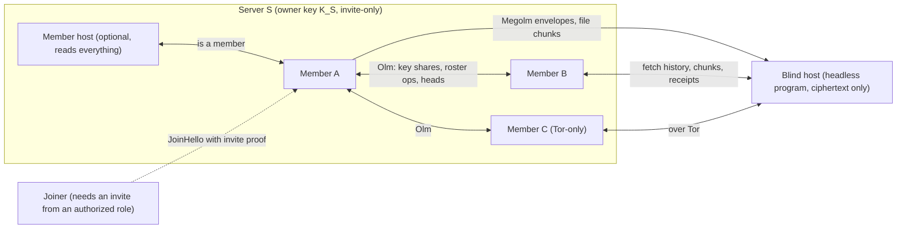
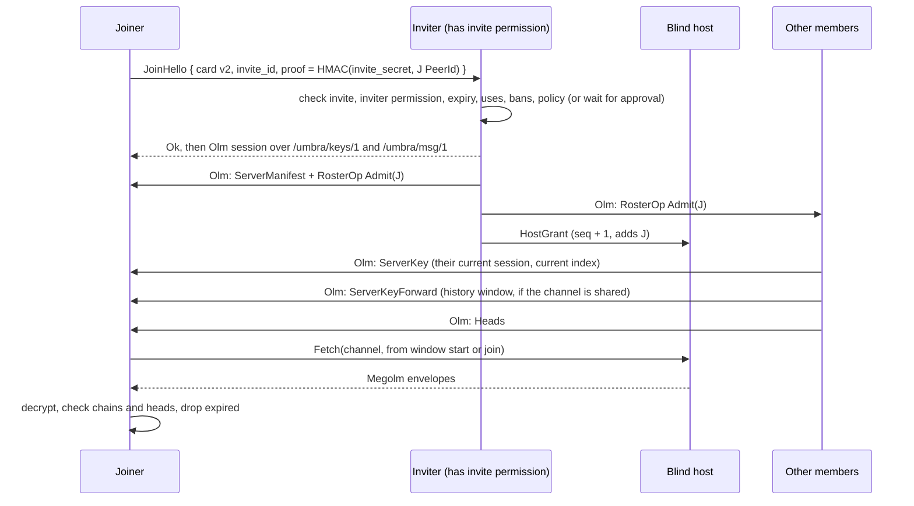

# Community servers (design)

Status: **design only, nothing here is implemented.** Written against main at
`b79c7af`. It builds on what core does today, described in
[architecture.md](architecture.md), [threat-model.md](threat-model.md),
[core-api.md](core-api.md) and [tor.md](tor.md). Numbers marked
**(proposed)** are design defaults we picked and can change. Everything
else is either read from the code or cited. Decisions marked **(Nyx)** are
Nyx's answers from 2026-10-19.

Nyx asked for Discord-style servers: channels, mostly peer-to-peer and hosted
by the community, contents hidden from everyone outside the server, and file
uploads, GIFs and link embeds. Nyx later added two features: **host sanity
checks** (clients notice when a host drops or withholds data) and
**disappearing messages**. This doc says how to build all of that on top of
the current core, and where the security story is weaker than "encrypted"
suggests. Device-side protections (screen security, app lock, view-once,
padding, anti-replay and anti-rollback) are in
[message-protection.md](message-protection.md).

## Summary of decisions

| Topic | Decision | Source |
| --- | --- | --- |
| Group crypto | vodozemac Megolm v1, one outbound session **per sender per channel**, keys shared over Olm | Pushback on Chi's call: Megolm is per sender, not per channel. See [Group crypto](#group-crypto) |
| Hosts | Default host is a **blind store-and-forward host**, shipped as a **standalone headless program**. It holds ciphertext and never gets session keys. A **member host** (headless member that reads everything) is allowed but labelled as one | Decided. Pushback on Chi's call: a member host can read everything |
| Who can talk to whom | New "co-member" trust class in core, because Olm today only works between mutual contacts. DMs from co-members who aren't contacts arrive as **message requests** | Decided |
| Membership | Owner-signed manifest with a sequence number, plus admin-signed roster ops. **Recovery keys are required** at server creation | Decided. Adds rollback and fork rules and ownership transfer |
| Invites | **Every server is invite-only.** Invites are **authorized-only**: only roles with the `invite` permission (owner and admins by default) can create them | **(Nyx)** |
| Public servers | **Not planned.** No public or listed servers | **(Nyx)** |
| Discovery | **Umbra runs no directory and no bootstrap.** The app only joins (by invite), creates, and shows your servers. User-added directories are a **proposed extension**, pending Nyx | **(Nyx)**, extension pending |
| History for new members | **On by default**: new members can read earlier history. Configurable per server and per channel. "History from join" is the alternative setting | **(Nyx)**, confirm with Nyx (see open questions) |
| Identity | A **default identity** used across servers, which users can customise per server (per-server profile). A **separate identity per server** is an option | **(Nyx)**, confirm with Nyx (see open questions) |
| Bans | Enforced by rotation and host ACLs. A banned member keeps whatever they already decrypted or hold keys for | Agrees with Chi, with that limit stated plainly |
| Files | Chunked, content-addressed, one key per file, fetched over a separate `/umbra/blob/1` | Agrees with Chi. Adds that fetching reveals your IP to whoever serves the chunks |
| Limits | **250 members, 100 MiB per file, 30-day host ciphertext retention** | Decided |
| Embeds and GIFs | Sender-side link previews. **No GIF provider or API key.** GIFs are ordinary encrypted file attachments, plus optional per-server sticker and GIF packs uploaded by admins | **(Nyx)** |
| Host sanity checks | Per-sender sequence numbers and hash chains inside the encrypted payload, sender-signed heads, host-signed receipts, and cross-checks with other members. Gaps that no expiry, retention or deletion explains raise an alert | New feature (Nyx) |
| Disappearing messages | Timer per chat or channel, or a role policy. The shortest timer wins. Signal-style: the timer starts at send on the sender's device and on hosts, and at read on each recipient's device, with a hard cap of sent + timer + 7 days. Expiry is inside the encrypted payload. Best effort | New feature (Nyx). Timer start decided by Chi |
| Names | The suffix is for **telling people apart, never for trust**. Hash-derived suffixes can be ground cheaply at any length people would read | Pushback on Chi's call 8. Math in [Names](#names-and-impersonation) |

## What exists today and what servers need

| Need | Core at `b79c7af` | Gap |
| --- | --- | --- |
| Encrypt to many peers | Olm v1 for 1:1 only. `PayloadBody` is `Text` or `Signal` | Megolm sessions, new payload kinds |
| Talk to a member who isn't your contact | Not possible. `Hello` from a non-contact gets `Rejected(NotAContact)` and raises `ContactRequest`. One-time keys are only served to contacts | Co-member trust class (below) |
| Offline delivery | Outbox only, 7-day TTL, and both peers have to be online at once | Hosts store and forward server traffic |
| Detect lost or withheld messages | Nothing. `Payload` has no per-chat sequence number, and an outbox entry that expires is silently dropped on the receiving side | Sequence numbers, hash chains and heads ([Host sanity checks](#host-sanity-checks)) |
| Disappearing messages | Not implemented (listed in architecture.md) | Expiry in the payload, purge on clients and hosts ([Disappearing messages](#disappearing-messages)) |
| Key change handling | `CoreEvent::KeyChanged`, `accept_key_change`, `reject_key_change` (PR #20) | Apply the same pins to co-members |
| Abuse limits | Token buckets in `engine/limits.rs` on `Hello`, contact requests and OTK claims (PR #20) | Per-member post, key-share and blob limits |
| Tor | SOCKS or embedded arti, dial-only. Onion listening is experimental behind `tor-listen` | Tor-only members can't receive direct fan-out, so they rely on hosts |
| `ik` bound to `ed` | Not signed, see threat model | Becomes a prerequisite (below) |

### Prerequisites in core

1. **Sign `ik` with `ed` (contact card v2).** Today `ik` is trusted because it
   arrived in a card you scanned or in a `Hello` over a Noise connection
   authenticated as that PeerId. In a server you get other members' keys from
   an admin's roster entry, not from your own scan. If the card carries
   `sig = ed25519_sign(ed, "umbra-card-v2" || PeerId || ik)`, any copy of a
   member entry can be checked on its own, and an admin can't attach a wrong
   `ik` to a real PeerId.
2. **Co-member trust class.** A peer whose card (with a valid v2 signature) is
   in the current roster of a server we're in may complete `Hello`, claim
   one-time keys and send Olm messages, but **only server-scoped payloads**
   are accepted from it. A `Text` DM from a co-member who isn't a contact
   arrives as a **message request** (decided): it's stored apart from the
   inbox, shows the server it came from, raises no notification beyond a
   collapsed "message requests" count, and sends no read receipt until the
   user accepts. Accepting makes them a contact. The existing per-peer buckets apply to
   co-members just as they do to contacts.
3. **Pins carry over.** If a co-member is also a contact, or appears in two
   servers, all copies of their keys have to match. A mismatch raises
   `KeyChanged` and stops key sharing to and from that peer until the user
   resolves it. (A separate per-server identity is a different key on
   purpose, and doesn't count as a mismatch. See [Identity](#identity-across-servers).)
4. **Generalise the outbox** so it can queue server-scoped Olm payloads (key
   shares, roster ops) as well as `Text`.
5. **`Payload` v2 for DMs**: add `seq`, `prev`, `skipped` and `exp`, used by
   [Host sanity checks](#host-sanity-checks) and
   [Disappearing messages](#disappearing-messages).

## Overview



There's no index or directory node in the picture. A server is only reachable
through an invite.

## Identifiers

| ID | Form | Notes |
| --- | --- | --- |
| `ServerId` | SHA-256 of the canonical CBOR of the genesis manifest, unpadded base64url | Commits to the first owner key, and stays the same across ownership transfers |
| `ChannelId` | 16 random bytes | Random, so hosts never see channel names |
| Member | The PeerId of the identity used in this server (the default identity, or a per-server one) plus its v2 card | One device is one member, like contacts today. Multi-device is still out of scope |
| `SessionId` | vodozemac `GroupSession::session_id()`, the session's Ed25519 public key in base64 | Globally unique |
| `MessageId` | UUID v4, as today | Deduplicated per server |
| `EnvHash` | SHA-256 of an envelope's bytes | What hash chains and receipts point at |
| `BlobId` | SHA-256 of a ciphertext chunk | Hosts can check a chunk without the key |

Every server also has a hidden **control channel** that every member can
read. It carries manifests and roster ops in Megolm, so a host can hold them
for offline members without being able to read them.

## Group crypto

### Megolm in vodozemac 0.11.1

Read from `~/.cargo/registry/src/*/vodozemac-0.11.1/src/megolm/`:

- `GroupSession::new(SessionConfig::version_1())` makes an outbound session
  with a random ratchet and its own Ed25519 signing key. `encrypt` produces a
  `MegolmMessage` that carries the `message_index` and is signed by that key.
  `session_key()` returns a `SessionKey` at the current index, signed by the
  session key.
- `InboundGroupSession::new(&SessionKey, config)` makes the receiving side.
  `decrypt` checks the signature and MAC and returns the plaintext and its
  `message_index`. It fails with `UnknownMessageIndex` for indices below
  `first_known_index()`.
- `export_at(index)` and `export_at_first_known_index()` produce an
  `ExportedSessionKey`, which has no signature. `InboundGroupSession::import`
  takes it. `advance_to(index)` permanently forgets earlier keys.
  `compare` and `merge` pick the better of two copies of the same session.
- Megolm v1 uses AES-256 with HMAC **truncated to 8 bytes**. v2 (full MAC) is
  behind vodozemac's `experimental-session-config` feature, which we don't
  enable, matching our choice of Olm v1. Pickles encrypt with a 32-byte key,
  just like the Olm pickles.

### Sessions

Megolm sessions are **per sender**: a `GroupSession` belongs to whoever sends
with it, and receivers hold an `InboundGroupSession` for each sender. So each
member keeps one outbound session per channel they post in, and an inbound
session for every other active sender in that channel. Chi's "a Megolm
session per channel" works out to one per sender per channel.

Sharing: before a member's first send in a channel (and after every
rotation), core sends `ServerKey { server_id, channel_id, session_key }`
over Olm to every current roster member who can read the channel. The
receiver stores the inbound session **bound to the Olm sender's PeerId**,
`server_id` and `channel_id`.

**Binding rule (the same lesson as the calls spoofing fix in #22).** On
decrypt, the sender, server and channel come from the stored binding, never
from the plaintext. The plaintext repeats `server_id` and `channel_id`, and
the message is dropped if they don't match the binding. A member can't post
as someone else, because they'd need that sender's session signing key, which
never leaves the sender.

Each outbound session also records the channel's **history policy at the
time it was created** (`shareable: bool`) and the effective disappearing
timer. Both matter below.

### Rotation

| Trigger | What happens |
| --- | --- |
| A member leaves, is kicked or is banned | Every remaining member marks their outbound sessions for the affected channels as stale, and makes a new session before their next send, shared only to the new roster |
| A member loses read access to a channel | The same, for that channel only |
| Time or message count | Rotate after **7 days or 100 messages, whichever comes first (proposed)**. These are Matrix's defaults for `m.room.encryption` (`rotation_period_ms` and `rotation_period_msgs`) |
| The channel's history policy changes | Rotate, so a session is never part shareable and part not |
| A disappearing timer is on | Also rotate at least once per timer period, so a whole session can be deleted once its last message expires ([Disappearing messages](#disappearing-messages)) |
| A member joins | No rotation. Senders share their current session at its current index. Earlier messages reach the new member only through history sharing (below), which is on by default |

What rotation can't do:

- **No post-compromise security inside a session.** Whoever has a session key
  at index *i* can decrypt every later message in that session until it's
  rotated. Megolm's ratchet only goes forward, so you get forward secrecy
  against earlier indices only if the receiver calls `advance_to` and throws
  the older copy away. With history sharing on, clients keep sessions from
  the start of the history window so they can forward them, which gives up
  that forward secrecy inside the window (see the tradeoff below).
- **A removed member keeps what they had.** They can still read every message
  they had keys for, including ciphertext a host keeps serving. Rotation
  protects messages sent after the removal, not before.
- **Cost.** Each rotation is one Olm message per reader, so a burst of
  rotations in an *N*-member channel with *N* active senders is about *N²*
  Olm messages. That's why servers are capped at **250 members** (decided).

### History for new members

**Decided (Nyx): on by default, configurable.** New members can read earlier
messages. The setting lives in the manifest:

| Setting | Where | Values |
| --- | --- | --- |
| `policy.history` | Server default | `shared` (default) or `from_join` |
| `channels[].history` | Per-channel override | `inherit` (default), `shared` or `from_join` |
| `policy.history_window` | Server | `retained` (default: everything hosts still hold, so up to the 30-day host retention) or a number of days |

`from_join` is the alternative: new members only read from the moment they
joined.

**Mechanism: forwarding exported Megolm session keys.** When a client sees
`Admit(J)` for a channel J can read whose effective policy is `shared`:

1. **Senders forward their own sessions.** Each member who posted in the
   window takes each of their own outbound sessions marked `shareable`, and
   sends `ServerKeyForward { server_id, channel_id, sender: self, exported }`
   over Olm to J, where `exported = export_at(i)` and *i* is the first
   message index that's inside the window **and not expired**. Since it
   comes over the sender's own Olm channel, it's bound to the sender as
   strongly as a normal `ServerKey`.
2. **Someone else covers absent senders.** For senders who are offline or
   have left, the inviter (or an admin, or a member host) forwards the copies
   it holds. These are marked "forwarded by X", because an
   `ExportedSessionKey` isn't signed: X could make up a session and claim it's
   S's. J's client checks each forwarded `session_id` against S's signed
   heads ([Host sanity checks](#host-sanity-checks)), which list the sessions
   S really used. Until a matching head is seen, messages from that session
   show as "forwarded by X, not yet confirmed by S". Forwards are accepted
   only from the original sender, from roles with the `invite` permission,
   and from member hosts.
3. **J fetches the window** from hosts and decrypts it with those sessions.

Rules:

- Only sessions created while the policy was `shared` are ever forwarded.
  Messages posted under `from_join` never become readable to later members if
  an admin switches the channel to `shared`, and switching to `from_join` stops
  new forwards (what was already forwarded can't be taken back).
- **Expired messages are never shared.** The export index skips past
  messages whose `sent + timer` has passed, sessions whose messages have all
  passed it are deleted rather than forwarded, and J's client drops anything
  whose `exp` has passed. For what J does get, J's own timer starts when J
  reads it, capped at `sent + timer + 7 days`.
- Forwarding is rate-limited per joiner and only goes to current roster
  members.

**Privacy tradeoff.** In a `shared` channel, posting means posting to
everyone who joins in the future, not just to the people there now. One
careless admit or one leaked invite exposes the whole window. Clients also
keep old session keys around for forwarding, so a compromised device leaks
the window's keys and not just the plaintext it already stored. The UI says
"New members can read history" in the channel header and above the composer,
so posters know. Channels for sensitive talk should be `from_join`, and can
add a disappearing timer.

### Missing keys

If a Megolm message arrives for an unknown `SessionId`, core keeps it in a
bounded pending queue (**500 messages per server, 7 days (proposed)**) and
sends `ServerKeyRequest` to the bound sender only, if that sender is in the
roster and reachable. The UI shows "Waiting for this message's key." A
request for an index before the requester joined is only answered in a
`shared` channel, and never for expired messages.

## Hosts

A host is an always-on node that stores and forwards server traffic for
members who are offline, and it's the only way Tor-only members (who can't
listen without the experimental `tor-listen`) get messages reliably. Nothing
depends on a node we run.

**Decided: the blind host is a standalone headless program**, separate from
the app: a `umbra-host` binary built from `core/` with the host role and no
UI, configured by a file (quota, retention, listen addresses, Tor). Sally
packages it next to the app. A member host is still a normal member running
headless core.

| | Blind host (recommended default) | Member host |
| --- | --- | --- |
| Holds | Megolm envelopes, encrypted file chunks, Olm envelopes queued for offline members, the host ACL | Everything a member holds, including session keys |
| Can read content | **No** | **Yes**, everything it holds keys for |
| Knows | Member PeerIds (from its ACL), connecting IPs, which member posts and fetches when, envelope sizes, coarse expiry times, how many channels there are | Everything |
| Can forge messages | No (Megolm signatures) | Only as itself |
| Can drop, delay or withhold | Yes, and clients detect it ([Host sanity checks](#host-sanity-checks)) | Yes |
| Who should run it | Anyone, including a VPS or a friend's server | Only the owner, on hardware they control |

**Recommendation:** blind hosts. A host that is also a member isn't
"encrypted against the host". It's a member with uptime. We allow member
hosts because some owners want a bot that answers key requests and forwards
history, but the UI labels them with a role badge ("Host, can read
everything") so members know. Chi's call 2 said "any member can act as a
host". That's fine for a blind host. A member host should be the owner's
own node.

**Host ACL.** The owner (or an admin) gives the host a signed `HostGrant
{ server_id, seq, members: [PeerId], quota, retention }`. It lists PeerIds
only, with no names, roles or channel names. The host accepts pushes and
fetches only from PeerIds in the newest grant, authenticated by the Noise
connection. A stranger probing the host gets `Rejected(NotAMember)`, which
still confirms that something is listening.

**Retention (decided).** Hosts keep ciphertext for **30 days** (host
ciphertext retention), and server policy can shorten it. This window is
signed into the manifest (`policy.retention`), so clients know which absences
are expected. Messages with a disappearing timer are dropped at their expiry
if that comes first. Deleting a message asks hosts to drop it. Honest hosts
do, and a hostile host might not.

**Tor.** A host should listen as an onion service once `tor-listen` stops
being experimental. Then neither side learns the other's IP. Until then,
Tor-only members reach a host through `relay_addrs` circuits, the same way
they reach contacts.

### Operator duties (legal-driven, phase 1)

These come from Syd's legal review of host exposure,
[legal.md §4 "Community servers and blind hosts"](legal.md#4-community-servers-and-blind-hosts),
mostly the settings list in §4.5. They're all part of `umbra-host` in phase 1. The
host stays blind throughout: it only ever acts on identifiers (`ServerId`,
`EnvHash`, `BlobId`, `PeerId`), never on content, because it can't read any.

**Operator contact (required).** The host config has a published contact
address (an email or a URL), and `umbra-host` won't start without one. This
is the single point of contact §4.1 lists (DSA Arts. 11 and 12) and the
notice address §4.5 asks for. An optional `dmca_agent` field holds the
designated agent's details as filed with the U.S. Copyright Office, if the
operator has registered one (§4.2; that means publishing a legal name and
street address, which is the operator's choice). The host signs a
`HostInfo { peer_id, operator_name?, contact, dmca_agent?, aup_sha256,
aup_version, logging: { ip_logs, retention_hours }, ts, sig }` and serves it
to members on `/umbra/srv/1`. The app shows it in the join preview and the
host info sheet, next to the blind or member badge, and to the owner when
they add the host. Where else the operator publishes the address
(a website, a `security.txt`) is up to them.

**Onboarding warnings and acceptable-use policy.** `umbra-host init` won't
write a config until the operator has read and acknowledged, interactively
(or with `--accept-aup <sha256>` for containers):

- The §4.5 onboarding text, word for word: you're hosting encrypted data you
  can't read for other people, you can still get legal process about it, you
  hold PeerIds, IPs (unless members use Tor), timestamps and sizes for up to
  the retention period, if you're told about illegal material you may have
  to act and report it (don't open or decrypt it), and you must be **18 or
  older** (or the age of majority where you live).
- The §4.5 jurisdiction caveat: the notes only cover US federal and EU-level
  law, and running a host is your own legal responsibility.
- You may get legal notices (takedowns, preservation requests) and you're the
  contact for them.
- Members see your host's IP unless it's an onion service.
- You can refuse or remove things by identifier, and under a hold you'll
  keep encrypted data past its expiry.
- The acceptable-use policy (AUP), using the §4.5 text: no child sexual abuse
  material, copyright infringement, threats or harassment, malware, or
  anything illegal; the host may remove specific items it's notified about
  and refuse service to any account; and the host contact.
- In **member host** mode (`umbra-host --member`), a stronger warning that
  the host can read everything it holds keys for and can get actual
  knowledge directly (§4, §4.5).

The acknowledgement (`aup.version`, `aup.sha256`, timestamp) goes in the
config. A new AUP version needs a new acknowledgement before the host starts.
Members see the AUP in the join preview (§4.5) and can open it from the host
info sheet. The owner has to accept it when adding the host.

**IP and connection logging: off by default (§4.5, §4.4).** `umbra-host`
keeps no IP or connection logs unless the operator turns them on with
`logging.ip_logs = true`. That's an explicit opt-in: `umbra-host` shows a
warning that the logs tie members' PeerIds to IPs and times, that they can
be obtained by subpoena (18 U.S.C. § 2703(c)(2)) or a DMCA subpoena
(§ 512(h)), that they're personal data under the GDPR, and that they undo
much of what members gain from hosting over Tor. The operator has to
confirm. Logs then rotate after **24 hours by default, 7 days at most
(proposed)**. Even with logging on, the host doesn't keep `Push`/`Fetch`
patterns or relay sender/recipient pairs after delivery (§4.4). Whether
logging is on, and for how long, is in the signed `HostInfo`, so members see
it in the join preview and host info sheet ("This host logs IP addresses for
24 hours"). It's in the threat model below and in
[threat-model.md](threat-model.md#metadata).

**Denylists.** The operator controls three lists in the config, or through
`umbra-host deny add|remove` (§4.5's blob and peer denylists):

| List | Matches | Effect |
| --- | --- | --- |
| `deny.blobs` | `BlobId` (a file chunk) or `EnvHash` (a message envelope), the SHA-256 of the ciphertext | Refuses to store or serve that item. Existing copies are deleted unless a hold covers them |
| `deny.peers` | `PeerId` | Refuses pushes, fetches and relays from that member, even if the owner's `HostGrant` lists it. This is how the repeat-infringer policy in §4.2 works |
| `deny.servers` | `ServerId` | Stops hosting the whole server |

Every refusal comes back as a **signed refusal receipt**:
`Refused { id, scope: Blob | Envelope | Peer | Server, reason: Denylist |
Takedown { notice_id }, statement?, ts, sig }`, signed by the host's key.
`statement` is the short statement of reasons DSA Art. 17 asks for (§4.1,
§4.5 step 3). For takedowns the host also queues it as a signed
`OperatorNotice` through its relay queue to the server owner and to the
PeerId that pushed the item. That includes
items in a `Fetch` range, which come back in a `refused` list next to the
envelopes. In [Host sanity checks](#host-sanity-checks) a gap covered by a
valid refusal from that host shows as **"refused by host operator"**, with
its own indicator (a grey "operator" mark, not the amber warning dot) and the
notice ID if there is one. It's never a warning, and it never notifies more
than once per host. Clients still try other hosts and members for the item,
because the refusal only covers that host. **An unsigned or unexplained gap
still raises a warning, as before.** A refusal for an item the host earlier
signed a `Stored` receipt for is fine (a takedown can come after storage),
and it shows as "removed by host operator after storing it".

The limit: denylists match exact ciphertext. Every file has its own random
key, so the same picture sent twice has two unrelated `BlobId`s, and a
known-content hash list (the kind used to scan for abuse material) can't
match anything on a blind host. That's a direct consequence of the
encryption, and the AUP and onboarding say so.

**Preservation holds.** On a lawful notice, the operator runs
`umbra-host hold add <notice.json>`. The host then keeps the named
ciphertext (`EnvHash`es, `BlobId`s, or everything for a `ServerId` or
`PeerId`) **past the 30-day retention limit and past disappearing-message
expiry**, until the hold is lifted or its `until` passes. The default
`until` is **90 days**, matching an 18 U.S.C. § 2703(f) request, and it can
be renewed for another 90 (§4.4). A CSAM report keeps the material for the
period §4.3 and §4.5 step 4 give (1 year after a CyberTipline report). A
hold snapshots only the named records and suspends deletion for them only.

- Held items past their signed expiry are kept but **not served** to members
  any more, so honest clients behave the same as without the hold.
- A hold keeps data rather than losing it, so it never triggers deletion or
  withholding alerts. Clients can't detect a hold at all, the same as any
  other retention. Whether members are told about a specific hold depends on
  the notice and the law (§4.4: tell the affected member when you're
  allowed to).
- A hold can only preserve what the host already stores: ciphertext and the
  metadata in its ACL and stores. With logging off (the default) there are no
  IP logs to preserve. Preservation isn't disclosure: nothing is handed over
  without legal process (§4.4).
- **A hold can't reach plaintext.** A blind host has no keys and no
  plaintext to hold. Members' clients still delete their own copies and keys
  at expiry, so held ciphertext can only be decrypted by someone who still
  has the keys, such as a member who didn't delete or a member host. A member
  host is a member, and holds on member hosts are outside this design.

**The privacy consequence, said plainly:** a disappearing message can
survive on a host as ciphertext after it "disappeared", for as long as a
hold lasts. The host can't read it. The warning shown when turning on a
timer, and the host info sheet, say this.

**Takedown notices.** Notices name items by identifier, because that's all
the host can act on. The format, accepted by `umbra-host takedown apply`:

```json
{
  "v": 1,
  "notice_id": "2026-10-19-0001",
  "received": "2026-10-19T19:00:00Z",
  "from": { "name": "…", "contact": "…" },
  "basis": "copyright | court-order | law-enforcement | aup | other",
  "reference": "case or claim number, optional",
  "action": "refuse | preserve | refuse-and-preserve",
  "server_id": "base64url ServerId",
  "items": [
    { "type": "blob", "id": "BlobId" },
    { "type": "envelope", "id": "EnvHash" },
    { "type": "peer", "id": "PeerId" }
  ],
  "until": "optional end of a hold"
}
```

People outside the server can't know these identifiers. They come from a
member: the app's message info has **"Report to host operator"**, which
builds a notice draft with the `ServerId`, the message's `EnvHash` and its
file's `BlobId`s, plus the operator contact from `HostInfo`. Sending it is
up to the member.

This matches the notice template in §4.5, and a notice naming the
`ServerId` plus `BlobId`s is what §4.2 calls enough to locate the material
(17 U.S.C. § 512(c)(3)(A)(iii), DSA Art. 16(2)(b)). For copyright claims the
JSON also carries the § 512(c)(3) statements and signature.

Operator workflow (the §4.5 takedown checklist, mapped to `umbra-host`):

1. Log the notice (`umbra-host notices` keeps date, sender and IDs locally,
   not sent to members).
2. `umbra-host takedown check` maps it to the items this host really stores.
   If nothing maps, reply asking for the `ServerId` and `BlobId`s.
3. Decide. The operator can't see the content, so it can't confirm what the
   item is. It acts on the notice and the sender's claim, or declines.
4. `apply`: disables access to those exact items and adds them to the
   denylist with the `notice_id`, so refusal receipts carry it, and sends the
   statement of reasons to the owner and uploader.
5. **CSAM:** `apply --preserve` holds the items, nobody views them, and the
   operator reports to NCMEC (US) or the police (EU) as §4.3 describes.
6. **Copyright:** `umbra-host takedown restore <notice_id>` handles a valid
   counter-notice (§ 512(g)), and repeated valid notices against one PeerId
   lead to `deny.peers`.

| The operator can | The operator can't |
| --- | --- |
| Refuse or remove specific envelopes and chunks by hash | See, check or describe the content |
| Stop serving a member (`PeerId`) or a whole server (`ServerId`) | Find "every copy" of a file, since each upload has a different `BlobId` |
| Preserve named ciphertext under a hold | Hand over plaintext or keys, since it has none |
| Say which PeerIds are in a server's ACL, and their IPs if it logged them (it doesn't by default) | Remove copies from members' devices or from other hosts |
| | Say who a PeerId belongs to |

## Host sanity checks

Nyx asked that clients notice when a host deletes, drops or withholds stored
data, and tell the user automatically. A blind host can't read or forge
anything, but it can make things disappear, and it can make them disappear
for only some members. The design makes every absence either **explained**
(by a signed expiry, retention, deletion or join window) or **flagged**.

### What each message commits to

Every Megolm plaintext (`ChannelPayload`) carries, per sender per channel:

| Field | Meaning |
| --- | --- |
| `seq` | 1, 2, 3, … across every session the sender uses in this channel. Unlike Megolm's `message_index`, it doesn't reset on rotation |
| `prev` | `EnvHash` of the sender's previous envelope in this channel, so the sender's messages form a hash chain |
| `exp` | Absolute expiry in ms, or none ([Disappearing messages](#disappearing-messages)) |
| `timer`, `timer_seq` | The effective timer when this was sent, and the `seq` of the sender's latest timer change |

These are inside Megolm, so the host can't see or change them, and they're
signed by the sender's session key.

**Heads (signed checkpoints).** A sender's client periodically signs its
position with its device key:

```
Head { server_id, channel_id, sender, seq, env_hash, ts,
       sessions: [SessionId], timer, sig = ed25519(ed, "umbra-head-v1" || …) }
```

It's sent every **50 messages or 6 hours of activity, and when the app goes
to the background (proposed)**, inside the channel (as a `Checkpoint` body)
and directly over Olm to online members. Heads are what tell a reader that
messages *should* exist even when nothing after them arrived. `sessions` lets
joiners confirm forwarded history keys.

**Host receipts.** A host answers each `Push` with
`Stored { cursor, receipt }`, where `receipt` is the host's signature over
`(server_id, channel_id, env_hash, cursor, ts)`. The sender keeps receipts.
If the host later doesn't return that envelope, the receipt proves it was
accepted, and it can be shown to admins.

### How clients audit a host

1. **Gap in a chain.** A reader holds a sender's `seq` *n* and *n + k* but
   not what's between. Message *n + k*'s `prev` names the missing envelope's
   `EnvHash`, so the client asks the host for it by hash
   (`GetEnv { hash }`), then walks back the chain. The host can't substitute
   anything, because the hash must match.
2. **Withheld tail.** A head (from the sender or from another member) says
   the sender reached `seq` *N*, but the host only returns up to *m < N*.
3. **Self-audit.** Each client fetches its own recent envelopes back from
   each host now and then (**every 6 hours, proposed**) and compares them with
   its receipts. That catches a host that withholds from everyone, which
   cross-checks alone can miss.
4. **Cross-checking heads.** Members exchange `HeadsDigest { server_id,
   channel_id, [(sender, seq, env_hash)] }` over Olm with **3 random online
   members every 30 minutes of activity (proposed)**, and on join. If another
   member has something you don't, you fetch it by hash from that member
   (members serve envelopes they hold over `/umbra/srv/1`) or from another
   host. That catches a host showing different members different things
   (split view).
5. **Several hosts.** If a server has more than one host, clients fetch heads
   from all of them and compare.

**Forks** are two different envelopes with the same sender and `seq`, or a
chain whose `prev` doesn't match. A blind host can't make these, because it
can't sign. So a fork always means the sender's client (or its session key)
misbehaved, and it's shown against the sender, not the host.

### Expected and unexpected absences

A missing item is **expected**, and only gets a quiet inline marker, if any of
these hold:

| Reason | How the client knows |
| --- | --- |
| It expired | Expiry here always means the signed `sent + timer`, never a recipient's read-based timer. For a gap between *a* and *b*, every missing item was sent between `ts_a` and `ts_b`, so it expired by `ts_b + max(timer_a, timer_b)`. If `timer_seq` in *b* points inside the gap, the timer changed there; timer changes never expire, so that item has to be present, and its absence is unexpected |
| Retention | It's older than `policy.retention` in the manifest |
| Deleted | A signed `DeleteMessage` op covers it |
| Before your window | It's before your join in a `from_join` channel, or before the history window |
| No access | It's in a channel your role can't read |
| Refused by host operator | The host returned a signed refusal receipt for that item ([Operator duties](#operator-duties-legal-driven-phase-1)). Shown with its own "operator" indicator, not as expected silence and not as a warning |

Everything else is **unexpected**. In particular, a host may only drop an
item **after** its signed expiry (with **10 minutes of clock-skew slack,
proposed**). Dropping it early is an alert, the same as any other drop.

**Offline senders are never suspicious.** Silence isn't a gap: if nobody has
seen a head or later message from a sender, the client has nothing to expect.
Only provable absences count, meaning something a later message, a head or a
receipt says exists. And if the host can't be reached at all, that's shown as
"host offline", not as withholding.

### Alerts and UX

| Level | When | What the user sees |
| --- | --- | --- |
| Info | Expected absence | Inline muted marker: "3 messages expired", "2 messages expired before delivery", "Older messages are past this server's 30-day retention". No notification |
| Operator refusal | A gap covered by a valid signed refusal receipt | A grey "refused by host operator" mark inline and on the host info sheet, with the notice ID if any. At most one notification per host |
| Warning | An unexpected absence that survives a re-fetch, a fetch by hash from at least one other source, and a **15-minute grace period (proposed)** | A persistent **host health** indicator on the server (an amber dot on the host badge and in server settings) with "Host H didn't return 2 messages from Ana". **At most one notification per host per day (proposed)**, and repeats fold into the same open incident |
| Critical | A host contradicts its own signed receipt, or cross-checks prove a split view | A blocking banner like forks and rollbacks, with the evidence (receipts and heads) that can be sent to admins over Olm |
| Sender fork | Two signed envelopes for one `seq` | Blocking banner against the sender |

If the missing items turn up later, the incident is closed automatically and
downgraded to "host was slow". The health page keeps a history of incidents
per host, so owners can decide to replace a host.

### What a blind host can and can't fake

| A blind host can | A blind host can't |
| --- | --- |
| Drop, delay or withhold envelopes, chunks or relayed Olm payloads | Forge, change or reorder a sender's messages (Megolm signatures plus `prev`) |
| Show different members different subsets (caught by cross-checks) | Fake a head or a member's `HeadsDigest` (device-key signatures, inside Olm) |
| Drop the gossip it relays for Tor-only members, which delays detection | Make an early drop look like an expiry (the expiry is in the signed plaintext) |
| Keep ciphertext after expiry or deletion. **Clients can't detect this** | Deny a push it signed a receipt for |
| Refuse service entirely (shown as "host offline") | Insert messages from non-members |

The weakest case is a server where every member reaches every other member
only through one host (for example, all Tor-only). That host can drop all
gossip and withhold uniformly. Self-audit still catches it for each sender's
own messages, but no one can see what others were shown. More hosts, or any
direct member links, fix that.

### DMs and the outbox

DMs don't go through hosts today, but the same checks apply to `Payload` v2:

- `seq` per direction per contact, `prev` = SHA-256 of the previous
  `Payload` plaintext, and `exp`.
- **Outbox expiry.** When an undelivered message expires from the 7-day
  outbox (or at `sent + timer`, if sooner), the sender's client marks it failed
  (as today) and the next message carries `skipped: [seq ranges]`. The
  receiver shows "1 message expired before it was delivered" as info, not as
  an alert.
- An unexplained gap in a DM is a warning ("A message from Ana is missing").
  Since DMs are direct, that points at a bug or data loss on one of the two
  devices, not at a host.
- **Relayed DMs.** Server-scoped Olm payloads (and any future store-and-forward
  DMs) that go through a host's `Relay` queue get host receipts, and drops
  are alerted on like channel envelopes.
- After a `Hello`, both sides send a `Heads` payload over Olm with their
  last sent and received `seq`, so a missing tail shows up as soon as they
  reconnect.

### How this fits the threat model

The threat model already lists "A relay operator drops traffic" and
"Undelivered messages" under availability. Hosts make that worse, because
they hold data for a long time. These checks turn silent loss into a visible
signal and give admins evidence to replace a bad host. They don't add
availability: a host that withholds can still deny service, and members
only learn about it. They also can't prove that a host deleted anything,
only that it didn't hand it over.

## Disappearing messages

### Timers and how they combine

| Source | Set by | Scope |
| --- | --- | --- |
| Chat timer | Either person in a DM (a signed `TimerChange` in the chat, Signal-style, last change wins) | Both directions of that DM |
| Sender timer | The sender, per channel, for their own messages | Their messages in that channel |
| Channel timer | Admins, in `channels[].timer` in the manifest | Every message in the channel |
| Role policy | Owner, in `policy.max_lifetime[role]` | Every message posted by that role |

**The shortest timer wins.** A message's lifetime is the smallest of the
timers that apply, and it doesn't disappear only if none apply. A sender can
make their own messages shorter-lived than the policy, never longer. Honest
receivers clamp anyway: they use `min(exp, ts + policy max, arrival + policy
max)` if a sender claims a longer `exp` than the policy allows.

### When the timer starts (decided, Chi)

It works like Signal:

| Where | Timer starts | Deleted at |
| --- | --- | --- |
| Sender's device | When the message is sent | `exp = sent + timer` |
| Hosts | When the message is sent | `min(sent + timer, stored + 30-day retention)`, rounded up to the hour (`exp_bucket`) |
| Each recipient's device | When that recipient reads it | `min(read + timer, sent + timer + 7 days)` |

The **hard cap** means an unread message on a recipient's device expires at
most `timer + 7 days` after it was sent, even if it's never opened. The
signed `exp` in the payload is always `sent + timer`, so hosts and the
integrity checks have one expiry time for everyone, while each recipient's
local clock starts on reading.

**Consequence, stated plainly:** a message can only be delivered before
`sent + timer`. Peer-to-peer delivery and the sender's outbox still work
until then (the outbox keeps a disappearing message for
`min(7 days, timer)`), and hosts hold it until `sent + timer`. If a recipient
is offline past `sent + timer`, the host has already purged it and the
sender has deleted it, so the recipient sees **"expired before delivery"**.
With a short timer (say 5 minutes), a member who's offline for an hour
misses those messages entirely. That's working as intended, not a host
fault.

Timer changes (`TimerChange` in DMs and a sender's own timer, manifest edits
for channels and roles) never expire themselves, and are shown inline
("Ana set messages to disappear after 1 day").

### Where the expiry lives

- **Inside the encrypted payload**: `exp`, `timer` and `timer_seq` in
  `ChannelPayload` and `Payload` v2. This is the authoritative value.
- **Signed channel settings**: channel timers and role limits are in the
  owner-signed manifest.
- **In the clear for hosts**: the envelope and blob headers carry
  `exp_bucket`, the expiry rounded **up** to the next hour, so hosts know
  when to purge. Clients check that it matches the plaintext, and treat a
  mismatch as a sender error. The host learns roughly how long each message
  lives, which is new metadata.

Edits, reactions and replies inherit the expiry of the message they target
(the same `sent + timer` on hosts, and the target's local expiry on each
device), and can't extend it.

### Deleting

On every client, when a message reaches its local expiry (`exp` on the
sender's device, `min(read + timer, sent + timer + 7 days)` on a
recipient's; checked at start-up and on a timer, **within 1 minute,
proposed**):

- delete the message row, its edits and reactions, and the quoted snippet in
  replies (shown as "Expired message");
- delete attachments: decrypted files, thumbnails, cached chunks and link
  preview images;
- delete it from the search index and from notifications that are still
  showing;
- drop it from the outbox if it never went out;
- SQLCipher runs with `secure_delete = ON`, with periodic WAL checkpoints, so
  deleted pages are overwritten rather than left in the file.

**Keys.** Olm already throws away per-message keys. For Megolm, a reader calls
`advance_to` past expired indices once no earlier message in that session is
still alive locally, and deletes a whole inbound session once its last
message has expired locally or hit the hard cap (rotation once per timer
period makes the cap line up). Senders delete outbound sessions once every
message in them has passed `sent + timer`. In `shared` channels, only
messages before `sent + timer` are ever forwarded, and a joiner's own timer
for them starts when they read them, under the same hard cap.

**Hosts** purge envelopes, chunks (blobs carry the longest `exp_bucket` of any
message that references them) and relayed Olm payloads at `exp_bucket`
(`sent + timer` rounded up to the hour) or at the 30-day retention limit,
whichever comes first. Neither raises an integrity alert. A host may not
drop anything earlier, and clients alert if it does
([Host sanity checks](#host-sanity-checks)). Whether a host really purged
can't be checked.

### Honest limits

Shown to the user when they turn a timer on, in plain words:

> Disappearing messages are deleted from your devices and from honest hosts.
> Anyone who receives them can still screenshot, copy or photograph them, or
> use a modified app that doesn't delete. A host can keep its encrypted copy,
> and must keep it if it gets a legal preservation hold. It can't read it.

Deletion is best effort. It protects against someone who gets a device
later, and keeps old messages from piling up. It doesn't protect against a
recipient. Member hosts are recipients. View-once, screen security and the
forward hint, and which of them are theatre, are in
[message-protection.md](message-protection.md).

## Membership, roles and moderation

### Manifest and roster ops

The **owner key** `K_S` is a dedicated Ed25519 key, not the owner's device
key, so it can be backed up and transferred without moving a device
identity. It lives in SQLCipher like the Olm account and never crosses the
FFI in the clear.

`ServerManifest` (signed by `K_S`, sent only over Olm, and kept by hosts
inside the Megolm-encrypted control channel):

| Field | Notes |
| --- | --- |
| `server_id`, `seq`, `prev` | `seq` goes up by 1 each time, and `prev` is the hash of the previous manifest |
| `owner`, `recovery` | The current owner public key, and **1 to 3 recovery public keys (required, decided)** |
| `name`, `icon` | `icon` is a `FileRef` |
| `channels` | `ChannelId`, name, kind (`text`, later `voice`), which roles can read and post, `history` override and `timer` |
| `roster` | v2 card, role (`owner`, `admin`, `member`), `added_by`, `added_seq`, optional signed per-server `profile` |
| `bans` | PeerIds |
| `hosts` | Host PeerIds and addresses |
| `packs` | Sticker and GIF packs, as `FileRef`s to pack lists ([GIFs](#gifs-stickers-and-packs)) |
| `policy` | `invite` (roles allowed to create invites, default owner and admin), `history`, `history_window`, `retention`, `max_lifetime` per role, slow mode, file size limit, previews allowed, new-member limits |

Admins have to act while the owner is offline, so they sign **roster ops**
with their device key: `RosterOp { server_id, base_seq, op, ts, sig }`,
where `op` is `Admit`, `Kick`, `Ban`, `Unban`, `DeleteMessage`,
`CreateChannel`, or `EditChannel`. `Admit` may be signed by anyone whose role
has the `invite` permission at `base_seq`, and only for a joiner who used an
invite that signer created. The other ops are admin-only. Only the owner
changes roles, permissions, recovery keys or hosts. Clients apply ops on top
of manifest `base_seq` if the signer held the needed permission in it. The
owner's client folds pending ops into the next manifest.

Rules that keep concurrent ops consistent: a ban beats an admit for the same
PeerId. An unban requires a newer `base_seq` than the ban. An op whose
signer lost the permission is dropped once a manifest without it is seen.

### Rollback and forks

- Clients store the highest `seq` they've seen and refuse anything lower
  (`ManifestRollback`). This stops a host or member from replaying an older
  manifest to un-ban someone.
- Two different manifests with the same `seq` and valid owner signatures
  mean the owner key is compromised or misused. The client freezes the
  server (read-only), raises `ServerForked`, and shows both.

### Owner key loss, compromise and transfer

**Decided: recovery keys are required.** `create_server` doesn't finish until
at least one recovery key exists. The app suggests giving it to someone else
(an admin's device, scanned as a QR code) or writing down an exported,
passphrase-wrapped copy.

| Event | What happens |
| --- | --- |
| Transfer | The owner signs manifest `n+1` with `owner = K_new`. Clients accept it because `K_S` (the key at `n`) signed it. `ServerId` stays the same |
| Loss with a backup | `export_owner_key(passphrase)` makes an Argon2id-wrapped blob. Restore it on a new device |
| Loss with no backup | A recovery key signs a `Takeover` manifest naming a new owner. Since recovery keys are required, this path always exists unless every recovery key is lost too |
| Compromise | A recovery-key `Takeover` that revokes `K_S` beats later manifests signed by `K_S`. If the attacker holds the recovery keys too, the server is lost: members have to move to a new server, announced over Olm by admins they trust |

Recovery keys should be held by different people on different devices.
They're as powerful as the owner key while the owner key is revoked.

### Invites and joining

**Decided (Nyx): every server is invite-only, and invites are
authorized-only.** Only roles listed in `policy.invite` can create invites.
By default that's the owner and admins. The owner can grant it to `member`,
but it's off by default. Clients and inviters refuse invites, `JoinHello`s and
`Admit` ops from anyone without the permission.

`umbra://join?...` carries: `server_id`, the owner key fingerprint, the
inviter's v2 card, an `invite_id`, a 32-byte `invite_secret`, an expiry
(**7 days by default, proposed**), max uses (**1 by default, proposed**),
an optional "needs approval" flag, and host addresses. The whole invite is
signed by the inviter. A link pasted through an untrusted channel can be
swapped wholesale, so the join preview shows the owner fingerprint and the
inviter's safety number if they're a contact.

An invite is a bearer secret until it's used up or expires. With history
sharing on by default, whoever uses a leaked invite first can read the
history window. That's why the default is a single use, and approval mode is
there for invites that have to be posted somewhere less private.



`JoinHello` is accepted from a non-contact only if `invite_id` is known and
`proof` checks out. It goes through its own `Hello`-style token bucket, so it
can't be used to flood `ContactRequest`s. A host can carry the `JoinHello` to
an inviter who's offline. The host can't admit anyone itself, because it
can't sign roster ops.

### Moderation in a P2P setting

| Action | What it really does |
| --- | --- |
| Kick | Removes from the roster, rotates sessions, removes from the host ACL. They keep old history and keys |
| Ban | Kick, plus their PeerId goes in `bans` so new invites from them are refused. They can make a new identity and get invited again. Invites are the real gate |
| Delete message | A signed `DeleteMessage` op. Honest clients and hosts hide or drop it. A copy that's already on someone's device stays there |
| Slow mode, new-member limits | Enforced by honest clients and hosts. A modified client can ignore them, but hosts and peers can still refuse its traffic |
| Report | Sent to admins over Olm with the `MessageId`. Admins are members, so they check the message with their own inbound session, and the Megolm signature proves who sent it |

## Discovery

**Decided (Nyx): Umbra doesn't list or discover servers.** There's no public
server, no Umbra-run directory and no Umbra-run bootstrap. The app has three
entry points:

- **Join**: paste or scan an invite.
- **Create**: make a new server (with its required recovery key).
- **Your servers**: the servers you're in, from the local store
  (`list_servers`).

A server is reachable only through an invite, which carries the host
addresses, so servers need no bootstrap of their own. Whether core ships
default bootstrap and relay nodes for the network in general is still open
decision 1 in [architecture.md](architecture.md).

**Public servers: not planned.** The earlier draft allowed listed servers that
anyone could join. That's gone. If it ever comes back, it needs the warning
that end-to-end encryption doesn't protect against someone who simply joins,
and anyone who joined could read the history window.

**Proposed extension, pending Nyx: user-added directories.** A user could add
a third-party directory address themselves. A directory would only hold
owner-signed `ServerListing { server_id, seq, name, description, icon,
join_hosts, expires, sig }` entries, with no member lists or contents, and
joining through one would still be **request-to-join**, approved by a role
with the `invite` permission, so servers stay invite-only. The costs, if
Nyx wants it: announcing shows the directory the owner's PeerId and IP, and
searching shows the searcher's IP and query, unless they're on Tor. A
directory can hide listings or show different people different ones, but it
can't forge them. Nothing in phases 0 to 3 depends on this.

## Identity across servers

**Decided (Nyx), to confirm with Nyx: a default identity that users can
customise per server.**

| Option | What it is | Linkability |
| --- | --- | --- |
| **Default identity** (default) | Your device identity (PeerId, v2 card) and your global display name and avatar, the same in every server and DM | Members of two servers, and your contacts, can tell it's the same person. Hosts of different servers can match your PeerId |
| **Per-server profile** | The same identity with a different name, avatar or bio for one server: a `profile` signed by your device key in your roster entry | Changes what people see, not what links you. Same PeerId, so anyone in both places can still link you, and your contacts still see your verified badge |
| **Separate identity per server** (option) | A fresh Ed25519 key, Olm account and v2 card made for that server at create or join | Not linkable by keys. What's left: on clearnet the same IP, timing (both identities online at the same moments), writing style, and a host that serves both servers. Contacts in that server don't get a verified badge until they verify the new key |

A separate identity needs real core work. Noise authenticates a libp2p
connection as one PeerId, so each identity needs its own swarm and its own
connections. In Tor mode each identity should use separate circuits
(arti stream isolation, or a separate SOCKS username with system Tor).
Otherwise one connection pattern links them. That's why it's phase 2.

## Files

| Step | Design |
| --- | --- |
| Key | A random 32-byte key per file |
| Cipher | XChaCha20-Poly1305 in RustCrypto's `aead::stream` (STREAM) construction, so chunks can't be reordered or the file truncated. That means a new dependency (`chacha20poly1305`), from the same RustCrypto family as our `sha2` and `hkdf` |
| Chunks | **256 KiB (proposed)**. Each chunk is addressed by `BlobId = SHA-256(ciphertext)` |
| Message | The Megolm message carries `FileRef { name, mime, size, chunks: [BlobId], key, thumb }` |
| Limits | **100 MiB per file (decided)**, and server policy can lower it. Hosts also enforce a per-server quota |
| Thumbnails | Made by the sender and uploaded as their own small encrypted blob |
| Metadata | **(app)** strips EXIF and GPS before upload, on by default |
| Expiry | Blobs carry `exp_bucket` when every message that references them disappears |
| Transport | `/umbra/blob/1` (`Have`, `Get { id, offset, len }`, `Put`), separate from messages. Chunks come from hosts or from members who have them |

Fetching a chunk shows whoever serves it your IP (unless you're on Tor) and
which file you wanted, though not what's in it. Members serving chunks to
other members shows each other's IPs, the same as direct messaging does
today. In Tor mode, fetch only from hosts. Large files aren't downloaded
automatically (**over 10 MiB, proposed**).

## Link embeds

These are built by the sender, like Signal. When the sender pastes a URL,
their client fetches the page, pulls out the title, description and one
image, and attaches `LinkPreview { url, title, description, image: FileRef }`
to the message. Receivers never contact the site.

- In Tor mode, the fetch goes through Tor (embedded arti or `tor_socks`).
  If that's not possible, previews are off. They're never fetched over
  clearnet in Tor mode.
- Previews are under the sender's control and can lie. The UI shows the
  domain from the actual `url`, not from the preview, and it renders the
  preview as text with no HTML.
- Fetching previews can be switched off in settings, and server policy can
  ban previews entirely.

## GIFs, stickers and packs

**Decided (Nyx): no GIF provider, no API key and no external search.** That
replaces the earlier GIF-search design, and removes the problem of a key
embedded in an AGPL binary.

- **A GIF is a file.** Users pick a GIF (or a WebP or short video) from
  their device and send it as an ordinary encrypted attachment, through the
  same XChaCha20-Poly1305 chunked path and limits as any file. The app keeps
  a local "recent and favourite GIFs" list of `FileRef`s, so resending one
  doesn't re-upload it.
- **Server packs.** Admins can upload sticker and GIF packs. A pack is an
  encrypted file holding `Pack { pack_id, name, items: [{ name, FileRef }] }`
  (**at most 200 items of 5 MiB each, proposed**), and the manifest lists the
  packs as `FileRef`s. Members fetch packs from hosts like any blob and cache
  them. Sending a pack item sends its `FileRef`, so nothing is uploaded
  again. Removing a pack is a manifest edit. Members who already have it keep
  it.
- Pack items never disappear on their own. A message that uses one does, but
  the pack's blobs stay until the pack is removed.
- A GIF link pasted into chat is just a link, with a sender-side preview.

Nobody contacts a third party to send or receive a GIF.

## Names and impersonation

Display names aren't unique. When two or more members of a server have
display names that look alike after NFKC normalisation, case folding and a
Unicode UTS #39 confusable skeleton, those members get a numeric suffix:

```
digest = SHA-256("umbra-name-suffix-v1" || PeerId bytes)
digits = decimal string of the digest
suffix = the shortest prefix of digits, at least 4 long (proposed),
         that is unique among the members with that name
```

It's deterministic, it only grows when another person with the same name
joins, and it's never shown when there's no collision.

**Why the suffix can't be trusted.** An attacker who wants a particular
suffix makes new device keys until `H(PeerId)` starts with those digits.
For a *k*-digit target that takes about 10^k tries. Ed25519 key generation
costs about one signature, and `openssl speed ed25519` on our box measured
about **31,500 signatures per second on one core**.

| Suffix digits | Expected tries | One core (~31,500/s) |
| --- | --- | --- |
| 4 | 10^4 | Under a second |
| 6 | 10^6 | About 30 seconds |
| 8 | 10^8 | About 53 minutes |
| 10 | 10^10 | About 3.7 days, or hours on a few dozen cores |

Making each try slower with the safety number's 5200 SHA-512 rounds only buys
a constant factor. The same box does about 2.2 million SHA-512s per second at
128 bytes, so 5200 rounds is about 415 tries per second, and 6 digits drops to
about 40 minutes on one core. To make grinding as hard as breaking a 64-bit
key, the suffix would need about 20 digits, and nobody would read that.

So, unlike Chi's call 8, **the suffix only tells people apart**. Trust comes
from the following:

- **Verified badge.** If the member is a contact you've verified (safety
  number), they get a badge, and that can't be ground.
- **Role badges** come from the owner-signed manifest, so impersonating an
  admin also means getting the admin role.
- **Lookalike warning.** When a name collides with a contact or with an admin
  or owner in the server, the newer member's name gets a warning ("Not the
  same person as …"). Per-server profile names go through the same check.
- **Avatars** are member-chosen and shown, but they're not identity.
- The full PeerId and safety number are always one tap away.

## Wire protocol additions

All CBOR over request-response unless stated otherwise, like `engine/proto.rs`.

**New `PayloadBody` variants (Olm, member to member).** They go at the end of
the enum, as for `SignalKind`. Older cores fail to decode them and reply
`Rejected(Malformed)`, which is acceptable before 1.0.

| Variant | Purpose |
| --- | --- |
| `ServerKey { server_id, channel_id, session_key }` | Share an outbound Megolm session |
| `ServerKeyForward { server_id, channel_id, sender, exported }` | History sharing. Marked as forwarded unless `sender` is the Olm sender |
| `ServerKeyRequest { server_id, channel_id, session_id, from_index }` | Ask the bound sender again |
| `ServerManifest { bytes }` | Owner-signed manifest |
| `ServerOp { bytes }` | Roster op |
| `ServerInvite { link }` | An invite sent in a DM |
| `Heads { scope, heads: [Head] }` | Signed heads for channels, or last sent and received `seq` for a DM |
| `HeadsDigest { server_id, channel_id, entries }` | Cross-check with another member |
| `TimerChange { timer }` | DM timer change. Never expires |

**`Payload` v2 (DMs):** `Payload { v: 2, to, id, ts, seq, prev, skipped?,
exp?, timer?, body }`.

**`MsgRequest::JoinHello { card, server_id, invite_id, proof }`** on
`/umbra/msg/1`, plus `RejectReason::NotAMember`, `InviteInvalid`,
`NotAuthorized` (inviter lacks the `invite` permission) and `Banned` at the
end of the enum.

**Megolm plaintext** (JSON, like `Payload`):

```
ChannelPayload { v, server_id, channel_id, id, ts, seq, prev, exp?, timer?, timer_seq,
  body: Text { text, reply_to? } | File { file: FileRef, caption? }
      | Edit { target, text } | Delete { target } | React { target, emoji }
      | Checkpoint { head } | TimerChange { timer },
  preview?: LinkPreview }
```

It's padded to power-of-two buckets up to 64 KiB **(proposed)** before
encryption, because blind hosts see envelope sizes.

**`/umbra/srv/1`** (to hosts, and between members for live fan-out and
cross-checks):

| Request | Response |
| --- | --- |
| `Push { env: Envelope }` where `Envelope { server_id, channel_id, session_id, exp_bucket?, megolm }` | `Stored { cursor, receipt }`, `Refused { receipt }` or `Rejected(reason)` |
| `Fetch { server_id, channel_id, after, limit }` | `Envelopes { items, refused: [Refused], next }` |
| `GetEnv { server_id, hashes: [EnvHash] }` | `Envelopes { items, refused }`. Hosts and members both answer, which is how gaps are filled |
| `Info` | `HostInfo` (operator contact, AUP hash and version, signed) |
| `Relay { to: PeerId, olm: { t, c }, exp_bucket? }` | `Queued { receipt }`. Store-and-forward of Olm payloads for offline members. The host sees who sent what to whom |
| `FetchRelayed` | `Relayed { items }` |
| `Grant { HostGrant }` | `Ok` |

The envelope has no sender field. Members find the sender through the
session binding, and the host knows it anyway from the connection.

**`/umbra/blob/1`**: `Have { ids }` returns which ones it has,
`Get { id, offset, len }` returns bytes, and `Put { id, bytes, exp_bucket? }`
returns `Stored`, `Refused { receipt }` or `Rejected(Quota | TooLarge | HashMismatch)`. `Get`
on a denylisted chunk returns `Refused { receipt }`.

There's no `/umbra/index/1`. Umbra doesn't do discovery (see
[Discovery](#discovery)).

**Live fan-out.** A sender pushes each envelope to its hosts and directly to
members who are online. libp2p gossipsub was considered and left out for
now, because topic subscriptions show who's in which server to every mesh
peer.

## Core API sketch (for Elite)

Same style as `api/umbra.rs`. These are sketches, not final signatures.

```rust
// Servers
async fn create_server(name: String, recovery: RecoverySetup, identity: IdentityChoice) -> Result<ServerInfo>; // recovery required
fn list_servers() -> Result<Vec<ServerInfo>>;  // the "Your servers" view
async fn leave_server(server_id: String) -> Result<()>;
fn export_owner_key(server_id: String, passphrase: String) -> Result<Vec<u8>>; // Argon2id-wrapped
async fn import_owner_key(server_id: String, blob: Vec<u8>, passphrase: String) -> Result<()>;
async fn transfer_ownership(server_id: String, new_owner: String /* PeerId */) -> Result<()>;

// Invites (only roles with the invite permission)
fn create_invite(server_id: String, opts: InviteOptions) -> Result<String>; // umbra://join?...
fn parse_invite(link: String) -> Result<InvitePreview>;
async fn join_server(link: String, identity: IdentityChoice) -> Result<ServerInfo>;
async fn approve_join(server_id: String, peer_id: String, approve: bool) -> Result<()>;

// Identity
async fn set_server_profile(server_id: String, profile: Option<Profile>) -> Result<()>; // None = use default

// Channels and messages
async fn create_channel(server_id: String, name: String, kind: ChannelKind) -> Result<Channel>;
fn list_channels(server_id: String) -> Result<Vec<Channel>>;
async fn set_history_policy(server_id: String, channel_id: Option<String>, policy: HistoryPolicy) -> Result<()>;
async fn send_channel_text(server_id: String, channel_id: String, text: String,
                           reply_to: Option<MessageId>, preview: Option<LinkPreview>) -> Result<MessageId>;
async fn send_channel_file(server_id: String, channel_id: String, path: String,
                           caption: Option<String>) -> Result<MessageId>; // GIFs too
async fn send_file_ref(server_id: String, channel_id: String, file: FileRef) -> Result<MessageId>; // pack items, recent GIFs
fn list_channel_messages(server_id: String, channel_id: String,
                         before: Option<i64>, limit: u32) -> Result<Vec<ChannelMessage>>;
async fn fetch_file(file: FileRef, dest_path: String) -> Result<()>; // progress via events
async fn build_link_preview(url: String) -> Result<LinkPreview>;     // sender side; Tor-aware

// Packs
async fn add_pack(server_id: String, name: String, items: Vec<String /* paths */>) -> Result<PackInfo>; // admins
async fn remove_pack(server_id: String, pack_id: String) -> Result<()>;
fn list_packs(server_id: String) -> Result<Vec<PackInfo>>;

// Disappearing messages
async fn set_chat_timer(peer_id: String, timer_secs: Option<u64>) -> Result<()>;
async fn set_my_channel_timer(server_id: String, channel_id: String, timer_secs: Option<u64>) -> Result<()>;
async fn set_channel_timer(server_id: String, channel_id: String, timer_secs: Option<u64>) -> Result<()>; // admins
async fn set_role_max_lifetime(server_id: String, role: Role, secs: Option<u64>) -> Result<()>;           // owner

// Members and moderation
fn list_members(server_id: String) -> Result<Vec<Member>>; // handle, suffix, role, verified, lookalike
async fn set_role(server_id: String, peer_id: String, role: Role) -> Result<()>;   // owner only
async fn set_invite_roles(server_id: String, roles: Vec<Role>) -> Result<()>;     // owner only
async fn kick(server_id: String, peer_id: String) -> Result<()>;
async fn ban(server_id: String, peer_id: String) -> Result<()>;
async fn delete_channel_message(server_id: String, id: MessageId) -> Result<()>;
fn list_message_requests() -> Result<Vec<MessageRequest>>;

// Hosting and integrity
async fn set_hosts(server_id: String, hosts: Vec<String>) -> Result<()>;
fn host_health(server_id: String) -> Result<Vec<HostHealth>>; // open incidents, history
async fn export_integrity_evidence(server_id: String, incident: String) -> Result<Vec<u8>>;
fn host_info(server_id: String) -> Result<Vec<HostInfo>>; // operator contact, AUP, refusal counts
fn draft_takedown_report(server_id: String, id: MessageId) -> Result<TakedownDraft>; // ServerId, EnvHash, BlobIds
// The blind host itself is the standalone `umbra-host` binary, not an app API.
```

**`umbra-host` config and CLI sketch** (TOML, phase 1):

```toml
[host]
listen = ["/ip4/0.0.0.0/tcp/4101"]
data_dir = "/var/lib/umbra-host"
quota_per_server = "5 GiB"
retention_days = 30

[logging]                  # legal.md §4.4, §4.5
ip_logs = false            # off by default; turning it on shows a warning and asks to confirm
retention_hours = 24       # only if ip_logs = true; max 168

[operator]
name = "Example Hosting"   # optional
contact = "abuse@example.org"   # required, published in HostInfo
# dmca_agent = "…"         # optional, as filed with the U.S. Copyright Office

[aup]
version = 1
sha256 = "…"               # written by `umbra-host init` after acknowledgement
accepted_at = "2026-10-19T19:00:00Z"

[deny]
blobs = []                 # BlobId or EnvHash
peers = []                 # PeerId
servers = []               # ServerId

[tor]
onion = false              # once tor-listen is stable
```

```
umbra-host init                       # warnings + AUP, writes the config
umbra-host run
umbra-host deny add|remove|list <blob|envelope|peer|server> <id>
umbra-host takedown check|apply|restore <notice.json | notice_id>
umbra-host hold add|lift|list <notice.json | notice_id>
umbra-host notices list               # local notice log
```

New `CoreEvent` variants: `ChannelMessage`, `ChannelMessageEdited`,
`ChannelMessageDeleted`, `ServerUpdated { server_id, seq }`,
`MemberJoined`, `MemberLeft { reason: Left | Kicked | Banned }`,
`JoinRequest`, `MessageRequest`, `KeyMissing { server_id, channel_id, count }`,
`FileProgress`, `ManifestRollback`, `ServerForked`,
`IntegrityAlert { scope, host, level, count }`, `IntegrityResolved`,
`SenderForked`, `MessagesExpired { scope, count }`, and
`Removed { server_id, reason }` when we're the one kicked.

Store (schema v3): `servers`, `manifests`, `roster_ops`, `channels`,
`identities` (default plus per-server), `megolm_outbound` (with `shareable`
and timer), `megolm_inbound` (session id, server, channel, bound sender,
first known index, forwarded-by, confirmed, pickle), `channel_messages` (with
`seq`, `prev`, `exp`), `heads`, `host_receipts`, `integrity_incidents`,
`pending_megolm`, `files`, `blobs`, `packs`, `message_requests`. The
`umbra-host` program has `host_envelopes` (indexed by `EnvHash` and
`exp_bucket`), `host_relay`, `host_denylist`, `host_holds` and
`host_notices`. Megolm pickles are encrypted with
`HKDF(db_key, "megolm-pickle-v1")`, kept separate from the Olm pickle key.
`mock: true` should fake a server with two channels and a few members,
including a name collision, an expired message and one open integrity
incident.

## UI notes (for Copilot)

- **Entry points:** Join (paste or scan an invite), Create, and Your servers.
  No browse or search screen.
- **Layout:** a server rail, channel list, message pane and member list,
  with role badges from the manifest.
- **Names:** show the suffix only on collision, in muted type after the
  name. Show the verified badge next to it. Mark lookalikes of contacts and
  staff with a warning. Never use the suffix to decide trust.
- **Join preview:** server name, owner fingerprint, the inviter (and their
  safety number if they're a contact), which hosts it uses and whether
  they're blind or member hosts, the history policy, and which identity
  you'll join as (default, with a profile, or a separate one).
- **History label:** "New members can read history" in the header and above
  the composer of `shared` channels.
- **Invites:** the invite button only appears for roles with the permission.
- **Host badge:** member hosts show "Host, can read everything".
- **Host info sheet:** operator contact, AUP, blind or member host, refusal
  count, whether IP logging is on and for how long, and a standing note that
  the host may preserve ciphertext under a legal hold. The join preview shows
  the contact, the AUP and the logging state too. "Report to host operator" in message info.
- **Host health:** an amber dot on the host badge while an incident is open,
  a health page in server settings, at most one notification per host per
  day, and blocking banners only for critical incidents and forks.
- **Undecryptable messages:** "Waiting for this message's key." Before your
  join in a `from_join` channel: "Messages from before you joined aren't
  available."
- **Disappearing messages:** a timer icon on the chat or channel, inline
  notices for timer changes, "N messages expired" markers, and the honest
  warning when turning a timer on.
- **Message requests:** DMs from co-members who aren't contacts go to a
  separate requests list.
- **Removed:** if you're kicked or banned, the server goes read-only with an
  explanation. Your history stays on the device unless you delete it.
- **Files:** show the size limit before upload, strip EXIF by default, don't
  auto-download over the threshold, and decode images off the UI isolate.
- **GIFs:** a picker over the device gallery, recent GIFs and the server's
  packs. No search box.
- **Previews:** a setting with a short privacy note. In Tor mode, "Previews
  are fetched through Tor" or "off".
- **Forks and rollbacks** get a blocking banner, not a toast.

## Threat model deltas

New assets: server membership (who's in which server), server content, the
owner and recovery keys, Megolm sessions, and the completeness of stored
history.

| Threat | Mitigation | What's left |
| --- | --- | --- |
| Host, relay or network reads content | Megolm inside Olm-shared keys. Blind hosts never get session keys | A member host reads everything, by definition |
| Host learns metadata | Random `ChannelId`s, no sender field in envelopes, padding | The host sees member PeerIds, IPs, timing, sizes, coarse expiry and who posts. Tor hides IPs only |
| Host logs IPs and hands them over (subpoena, DMCA subpoena) | `umbra-host` logs nothing by default. Logging is an explicit opt-in with a warning, rotates in 24 hours by default (7 days at most), and is shown to members in the signed `HostInfo` | A host that turns logging on, or a modified host that logs without saying so. Tor and onion hosts are the real fix |
| Host drops, withholds or splits history | Hash chains, signed heads, host receipts, self-audit and cross-checks raise alerts | Detection only, not availability. A host that's every member's only path can hide what others were shown |
| Host purges early and calls it expiry | The expiry is in the signed plaintext | None. It's alerted like any drop |
| Host keeps data after expiry or deletion | None possible | Undetectable. Only an honest host purges |
| Legal preservation hold keeps expired ciphertext | Holds only cover ciphertext the host already has, held items aren't served past expiry, members' clients still delete copies and keys, warning in the timer UI | An expired message can survive on the host as ciphertext for as long as the hold lasts. Anyone who still has the keys could decrypt it. Holds are invisible to clients |
| Host operator refuses or removes items (denylist, takedown) | Signed refusal receipts, shown as "refused by host operator", not as silent withholding. Other hosts and members can still serve the item | A host can censor openly. Owners see the refusal counts and can replace the host. Bogus notices are the operator's call |
| Takedown targeting by content | Not possible on a blind host: denylists match exact ciphertext only | Known-content hash lists can't match. Reports depend on a member supplying identifiers |
| Member impersonates another member | Session binding from Olm, Megolm signatures, v2 cards | Display-name impersonation, handled by badges and lookalike warnings, not by the suffix |
| Forged history forwarded to a new member | Forwards marked "forwarded by X" and checked against the sender's signed heads | Unconfirmed until a head from the sender arrives |
| Sender shows different content to different members | Hash chains and cross-checked heads now reveal it as a sender fork | Detected after the fact, not prevented |
| Removed member reads new messages | Rotation on leave, kick or ban, and removal from the host ACL | They keep everything they already had, and a member who's slow to rotate leaks until they do |
| New member reads earlier history | It's the default (Nyx). `from_join` per server or channel, labels in the UI, expired messages never shared | Anyone admitted reads the window. A leaked invite exposes it. Old keys stay on devices for forwarding |
| Stranger joins | Every server is invite-only, invites are authorized-only, single use and 7 days by default, approval mode | An invite is a bearer secret until used. Ban evasion with a new identity needs a new invite |
| Compromised member device | Periodic rotation | No post-compromise security until the next rotation, and the shared-history window's keys |
| Rolled-back manifest un-bans someone | `seq` and `prev` checks | A client that has never seen the newer manifest will accept the older one |
| Owner key stolen or lost | Required recovery keys, fork detection | If the recovery keys go too, the server is lost |
| Fetching files shows IP | Hosts in Tor mode, no auto-download | Whoever serves the chunks sees your IP on clearnet |
| Receivers leak IP through embeds or GIFs | Built by the sender, GIFs are files, no GIF provider | Sender's IP goes to the site for previews unless they're on Tor |
| Malicious files or images | Size caps, hash checks before decrypting, decoding off the UI isolate | Image and video decoders run on attacker input, so keep them sandboxed and up to date |
| Recipient keeps disappearing messages | Clients delete at expiry, honest warning in the UI | Screenshots, copies and modified clients. Best effort only |
| Same identity in every server | Per-server profiles change names; separate identities per server unlink keys | The default identity is linkable across servers. Separate identities still link through IP on clearnet and timing |

### Abuse and spam

| Vector | Limit (all proposed unless marked) |
| --- | --- |
| Posting | Per member: burst 5, then 1 every 2 s, enforced by hosts and honest clients. Slow mode in policy |
| New members | No files or links for the first 24 h, if policy turns it on |
| Joins | Invite-only and authorized-only (decided). Invites expire and have max uses, approval mode is optional, and `JoinHello` is token-bucketed per PeerId like `Hello` |
| DMs from co-members | Message requests (decided), collapsed, token-bucketed |
| Key requests, shares and forwards | Per-member token bucket. Shares from non-roster peers are dropped |
| Heads and digests | Per-member token bucket. Heads from non-roster peers are dropped |
| Junk envelopes | Pending queue capped at 500 per server. Unknown sessions from non-members are dropped |
| Storage | Per-server host quota, 30-day host retention (decided), 100 MiB file cap (decided), 250 members (decided) |

### New invariants

| # | Invariant |
| --- | --- |
| S1 | Server content only goes on the wire inside Megolm |
| S2 | Megolm session keys only travel inside Olm, to current roster members |
| S3 | The sender, server and channel of a Megolm message come from the session binding, never from the plaintext |
| S4 | Blind hosts never get session keys or plaintext manifests |
| S5 | A client never accepts a manifest with a lower `seq` than the highest it has seen |
| S6 | Receivers never fetch a third-party URL for an embed or GIF |
| S7 | File chunks are checked against their `BlobId` before decrypting, and fail closed |
| S8 | An invite, `JoinHello` or `Admit` is only accepted if its signer's role has the `invite` permission in the manifest it names |
| S9 | Exported session keys are only forwarded from sessions created under a `shared` policy, to current roster members, and never for expired messages |
| S10 | A missing item is shown as expected only if a signed expiry, retention window, deletion or join window explains it, or as an operator refusal if a signed refusal receipt covers it. Anything else is an integrity alert |
| S11 | Expired content is removed from the message store, attachments, search index and outbox, and its keys are dropped once nothing alive needs them |
| S12 | A host refusal is shown as "refused by host operator" only with a valid signed refusal receipt from that host. Anything unsigned stays an integrity warning |
| S13 | A blind host never serves an item past its signed expiry, even while a hold keeps it |
| S14 | `umbra-host` keeps no IP or connection logs unless `logging.ip_logs` is on, and `HostInfo` always says whether it is |

## Phasing

| Phase | Scope | Needs |
| --- | --- | --- |
| 0 | Card v2 (`ik` signed by `ed`), co-member trust class with message requests, outbox generalisation, `Payload` v2 (`seq`, `prev`, `skipped`, `exp`), padding and the replay record for DMs | Elite |
| 1 | Servers, text channels, authorized-only invites, roles, kick and ban, required recovery keys, rotation, history sharing (on by default, configurable), the standalone `umbra-host` blind host **with operator duties from legal.md §4 (published contact, onboarding warnings and AUP, IP logging off by default, blob, peer and server denylists with signed refusal receipts, preservation holds, takedown notices)**, files and GIFs as files, per-server profiles. **Host sanity checks:** hash chains, heads, host receipts, self-audit, cross-checks, alerts and the host health page for channels, DMs and the outbox. **Disappearing messages** for DMs and channels, with role policies | Elite (core and `umbra-host`), Copilot (UI), Sally (packaging `umbra-host`), Val (onion hosts once `tor-listen` is stable) |
| 2 | Link previews, server sticker and GIF packs, separate identities per server, integrity evidence export | Elite, Copilot |
| 3 | Voice channels | Gem |
| Not planned | Public servers, an Umbra-run directory or bootstrap, GIF providers. User-added directories are a proposed extension pending Nyx | |

Device-side protections (app lock, screen security, view-once, anti-rollback, duress PIN, sealed sender) use the same phases, ranked in [message-protection.md](message-protection.md#ranked-value-versus-cost).

**Voice (phase 3, with Gem).** Today's calls are 1:1 flutter_webrtc with SDP
inside Olm signals. For groups there are two options:

- **Mesh**: every member connects to every other one, so each sends its
  stream *n − 1* times and sees everyone's IP. Cap it at **4 participants
  (proposed, Gem to confirm)**.
- **SFU**: a forwarding server is cheaper on bandwidth, but it sees media
  unless frames are encrypted end to end. flutter_webrtc exposes a
  `FrameCryptor` API (used by LiveKit's Flutter SDK), which could carry
  frames keyed from Megolm. Gem should confirm this works on all three
  platforms. The SFU also sees everyone's IP, so in Tor mode it's TURN-only
  or no voice, the same as 1:1 calls in #24 and #25.

## Open questions for Nyx

1. ~~**Hosts:** headless blind-host build, or members' desktop apps?~~
   **Decided:** a standalone headless program (`umbra-host`).
2. ~~**Public servers in v1?**~~ **Decided (Nyx):** no public servers. Every
   server is invite-only, and invites are authorized-only (owner and admins by
   default).
3. ~~**Index:** a default index, or none?~~ **Decided (Nyx):** Umbra runs no
   directory or bootstrap, and the app only joins, creates and shows your
   servers. **Still open:** whether to add the proposed user-added directories
   extension.
4. **History default.** Decided as **on by default, configurable per server
   and per channel**, with "history from join" as the alternative, as Nyx
   said. **Confirm with Nyx**, because a later relayed decision said
   otherwise.
5. ~~**Limits:** 250 members, 100 MiB files, 30-day host retention?~~
   **Decided:** yes. The 30 days is host ciphertext retention.
6. ~~**DMs from server members** who aren't contacts?~~ **Decided:** they
   arrive as message requests.
7. **Identity across servers.** Decided as **a default identity that users can
   customise per server**, with a separate identity per server as an option,
   as Nyx said. **Confirm with Nyx**, because a later relayed decision said
   otherwise.
8. ~~**GIF provider?**~~ **Decided (Nyx):** none at launch. GIFs are encrypted
   file attachments, plus server packs. No API key and no external search.
9. ~~**Owner recovery:** required or optional?~~ **Decided:** required at
   server creation.
10. **Legal:** host operators store ciphertext they can't read, for people
    they may not know, and now purge on expiry. The operator duties that Syd's
    review asked for are in [Operator duties](#operator-duties-legal-driven-phase-1),
    with the analysis in [legal.md §4](legal.md#4-community-servers-and-blind-hosts).
    **Open:** the items Syd couldn't verify in §4.6, and whether members can
    be told about a specific hold.
11. ~~**Disappearing timer start.**~~ **Decided (Chi):** Signal-style. The
    timer starts at send on the sender's device and on hosts, and at read on
    each recipient's device, with a hard cap of `sent + timer + 7 days` for
    unread messages. Hosts delete at `sent + timer` or at 30-day retention,
    whichever comes first. See [When the timer starts](#when-the-timer-starts-decided-chi).
